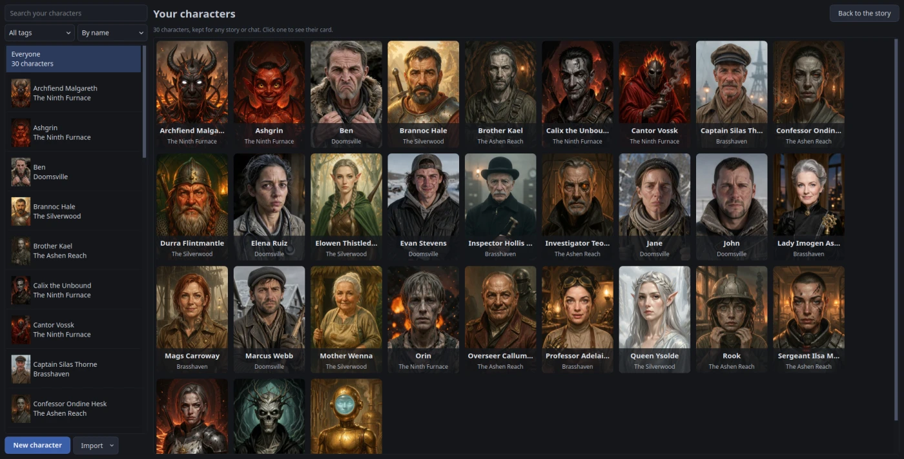

# Changelog

What each version of SealedLore brought before 3.5, newest first. Version
3.5 is in the [README](README.md#new-in-version-35), and each release's own
notes are on the [releases page](https://github.com/DigitalArchon/SealedLore/releases).

## New in version 3

- **Long lorebooks that still fit, and `{{user}}` and `{{char}}` kept**
  (3.1.0b16). Always-on lorebook entries can have **condensed versions**,
  written by the model beside the entry and never in its place, and sent
  only when the always-on lore is more than the lore budget holds: the
  fewest needed, least important first; Lorebooks can write them too, for
  every story made from the lorebook. The Lore page says when always-on lore
  is too much, and its **Always-on entries…** lets you make any of them
  fire by keyword instead. Under SillyTavern's rules, always-on
  entries no longer crowd every other entry out of its budget. Cards and
  lorebooks keep `{{user}}` and `{{char}}` as written, and the names go in
  whenever anything is sent: `{{user}}` is the story's player, even when you
  switch characters, and `{{char}}` the character whose card or lorebook
  the text came from (Story → Setup… → About). And a lorebook written by a
  stranger can no longer hang or fail a turn.
- **Lorebooks of their own, and lore that fits** (3.1.0b15). **Lorebooks**
  keeps SillyTavern lorebooks (and those it imports from NovelAI, Agnai and
  RisuAI) outside any story, exactly as they came, to change, export, or
  start any number of stories in, with whoever you like from Your
  characters. **Find the people…** reads a lorebook for the people it
  describes and makes them characters, cast or supporting, as you choose. A
  story from a lorebook asks which rules its lore fires by: **SillyTavern's
  rules** (the default: every entry's second keywords, chance, sticky,
  cooldown, delay, groups and order work as they did there) or
  **SealedLore's rules**, and you can switch on the Lore page. Under
  SealedLore's rules lore has room for its share of the context, a long
  entry is sent in part rather than dropped, and the entries are ranked on
  your own turn, by meaning and by every word of an entry. Pictures can be
  drawn for free on a server of your own (ComfyUI or AUTOMATIC1111 /
  Forge), and lore embedded on this computer by a built-in model, with no
  embeddings service at all. As chapters are archived the story suggests new
  lore entries, changes to entries and additions to cards, for you to take
  or turn down (Story → **Suggestions from the story…**). Review settings
  and Change the story with the model now know all of this, and characters
  played by their own model, and can propose changes to any of it.
- **Model profiles, every call in view, and characters written with AI**
  (3.1.0b14). Settings → Models keeps whole sets of models, each job's model
  and its route, to put back with one choice: **Default** (what a new setup
  starts with), **Recommended** (the best measured for each job, whatever it
  costs: Claude Opus 5.5 writes) and **Private** (end-to-end encrypted models
  for every job, on NanoGPT's Private Mode or Tinfoil), or your own mix saved
  under a name. A story's Setup → Models can take a profile as its own. **View
  → AI calls this session…** lists every call made to a model since SealedLore
  started: what it was for, the model, the endpoint and any host asked for,
  whether it was end-to-end encrypted, its tokens, time and cost, never what
  was said, and only in memory. A story whose every model is end-to-end
  encrypted now marks its passages so, as a private scene does. In Your
  characters, **Write with AI** expands a character's profile or writes it
  anew, as you ask (tougher, shyer, a criminal version) or from the world they
  come from, field by field for you to take; and a picture can be copied or
  moved to another character, so versions of one character share the pictures
  that fit. Stories and settings now say which version of SealedLore's layout
  they are saved in, so an older SealedLore no longer quietly loses what a
  newer one saved: it asks before opening such a story, and doesn't save over
  such settings.
- **Characters played by their own model** (3.1.0b14, a trial). A main
  character can be played by a model of their own, as another player beside
  you: after each passage they say what they mean to do, from only what they
  have seen and remember, and the storyteller works their answers in with
  your turn. Choose it under **Played by** on their card or when you start a
  story; their answers show under the passage, hidden until you send unless
  you ask, and each can be edited. A cheap model keeps a public record of
  what everyone knows by now, so a character who was away still hears the
  news, and a passage that moves is given to each of them only as far as
  they were there for it. Every model field now says which models
  are recommended for that use and which get prompts worded for them, with
  the reasons under **Help → Models SealedLore recommends and adjusts for…**.
- **More end-to-end encrypted providers** (3.1.0b13, preliminary). Tinfoil's
  own API and Chutes work beside NanoGPT: Tinfoil's models are end-to-end
  encrypted to its attested router, and Chutes is an endpoint for all its
  models, its `-TEE` ones always end-to-end encrypted to an instance the app
  has attested, their replies streamed. Each model's privacy level (highest,
  partial or not private) is said wherever it is chosen, and a private chat
  or scene moves only to a model as private or more. OpenRouter's cache
  writes and picture prices are read right, Continue reads its own reply
  from the cache, and file dialogs leave the desktop's recent files and Qt's
  folder history alone. A key that would go over plain http to another
  machine, or to an address it wasn't saved for, is held back until you
  confirm it. A story drafted around your characters reads their whole
  lorebooks, and a character joining a story you already have brings their
  lorebook only if you ask, its entries yours to choose and change for that
  story. Settings' **Save** keeps the window open (Save and Close closes it),
  and phone access runs tor 0.4.9.17.
- **Livelier play** (3.1.0b12). When your turn only waits, or lets time
  pass, the storyteller makes the next move instead of describing the room
  again, and it is reminded of the habits its recent passages have fallen
  into. A story can keep **storyteller's notes** (Story → Setup… →
  Storyteller's notes): its secrets, what people want and hide, sent to the
  storyteller alone. A draft or a plot the model writes can write them, and
  you don't see them unless you ask. **Regenerate with a note…**, **Change
  this passage…** and **Suggest…** are on the desktop and the phone. The scene
  card keeps what is still open, a promise or an appointment, from scene to
  scene, and plots fit the moment they begin in better.
- **Updates, and a second review** (3.1.0b11). AppImageUpdate, Gear Lever and
  AppImageLauncher can now update the AppImage, downloading only what changed.
  A review of the whole app fixed about thirty bugs, among them a way anyone
  who knew your phone's onion address could keep your phones locked out,
  saves that a crash could leave unopenable, two copies of the app
  overwriting each other's changes, and Stop not reaching every call. Names
  from imported cards are always shown as text.
- **TEE models say what was attested** (3.1.0b9). The model button says
  whether the attested machine is the model's own or RedPill's TEE gateway,
  which passes requests on to the provider that runs the model, and what that
  leaves to someone's word. Your own messages are marked as received by the
  attested TEE only when a reply proves it. **Name the provider behind each
  TEE reply** (Settings → Private, off by default) shows who ran it ("run by
  Phala"). The release also fixes about fifty bugs found in a review of the
  whole app, the most serious being ways a private scene could reach another
  model.
- **The cast board, in one place** (3.1.0b2). A story's characters are on
  one page, laid out as Your characters is: **Cast board…** on the People page
  shows everyone down the left, and each one's card and pictures in two tabs
  (the Cast page has gone into it). It says plainly that it is this story's
  own, and Save to Your characters… keeps any of them for other stories. On
  the sheet of looks and expressions, rows and columns stay where you put
  them (drag a heading, or Move up and down), each heading has the words its
  pictures are drawn with ("happy, but reserved, a small smile"), a missing
  picture is a blank place showing what it would be drawn as, and the row for
  pictures set aside is always there.
- **Characters in a simple chat** (3.1.0b2). A chat can have characters for
  their pictures alone: bring them in on the People page or the cast board
  (from Your characters, a new card or a SillyTavern card), choose how each is
  shown, and draw new pictures of them. Nothing about them is sent to the chat's model;
  their pictures go with a picture you ask for, as a story's do.
- **A plot without writing one** (3.1.0b1). The model can write a story's
  plot: made up from the story's world and characters, or from what you
  describe (how many events, how often, how big, how disruptive, what kinds).
  Offered as the last step of Write a story from scratch, when drafting from
  an idea, and in Story → Plot → Write a plot with the model…. It stays hidden unless
  you ask to see it. Story → Plot → Open in the plot editor… opens a story you
  already have in the plot editor with everything filled in: write its plot,
  change anything else, and save it as a new story, the old one left as it
  is. The editor now shows which parts are the story's and which the plot's.
- **Ask for changes** (3.1.0b1). Once a story is drafted for you, or a plot
  written, say what you'd like different: "I like the world, but I'd prefer
  the characters were more badass", "the world isn't hostile enough". The
  model changes just that, the rest stays as it is, and **Undo the last
  change** takes any request back. A plot stays hidden while it is changed.
- **As much as you want set up** (3.1.0b1). Drafting from an idea asks how
  much world to write (basic, standard or detailed), how many people (a
  handful, standard or lots) and how much about each of them (briefly,
  standard or in depth), and a plot the model writes can bring in a few
  newcomers or many, written briefly or in depth. The draft also sets how
  lively the world is and, when the premise says, how its pictures look.
- **Cast cards that fit** (3.1.0b1). The cast's cards get room in proportion
  to the story's context budget (Settings → Context), and a card past it is
  condensed to about a third of its length instead of being cut to a line.
  Each character's card on the cast board shows its condensed text, to edit
  or have written again.
- **A story's characters, kept** (3.1.0b1). Cast board → Save to Your
  characters… keeps any or all of a story's characters in Your characters,
  linked to the story.
- **Your characters** (3.0.0b1). Every character you keep, in one place
  outside any story (File → Your characters…, or the start page). Import
  SillyTavern cards (PNG, CHARX or JSON files, or a link to Chub or
  RisuRealm) with every field and file they have (a background, the pictures
  their greetings show, sounds), or make your own; give them
  pictures on the cast board's sheet of looks and expressions; keep versions
  of one. Put any of them into a story as you set it up or while you play
  (Cast board → From Your characters…), and keep any or all of a story's
  characters there (Cast board → Save to Your characters…). When a story
  changes them (a new picture, a changed description), their card on the
  cast board says so, and **Changes…** saves the change to their card, makes
  a new version of it, or keeps it in that story only. **Chat with them…** starts a simple chat from their card
  and a greeting of theirs, and **Draft a story with them…** has a story
  drafted around them from your premise. Simple chats keep your favourite
  system prompts (**Saved prompts**). A SillyTavern card imported from File
  now goes into Your characters.

- **Characters with many faces** (3.0.0b1). A character's pictures can be
  labelled with the look they wear (a winter coat, combat armour) and the
  expression of the moment, and the picture that fits is chosen after each
  passage: on the People page, and if you like on a stage under the story and
  beside each passage (View). **The cast board** (**Cast board…** on the
  People page) takes the whole window: every character's card, and their
  pictures as a sheet of looks and expressions, the missing ones drawn in a
  few clicks. Doomsville's John and Jane come in four expressions and three
  looks.

- **A picture style for each story** (3.0.0b1). Gritty and realistic, clean
  and polished sci-fi, glamorous, anime, painted fantasy and more, your own
  words, or the style of a picture you have. Portraits can be head and
  shoulders, upper body or full body, and **Restyle pictures…** redraws
  imported pictures to match.
- **Continue, prompt sets and SillyTavern cards** (3.0.0b1). **Continue** a
  passage from where it stopped, share your prompt edits as a prompt set, and
  bring **SillyTavern** character cards and lorebooks in and out, from a file
  or a link.
- **Every part of a character can be changed** (3.0.0b2). In Your
  characters, a card's lorebook can be edited entry by entry, its files added,
  renamed, retyped or taken off, and every other field it carries changed,
  down to other apps' settings. Export it as changed, for others to use, or
  change a copy and keep the original. A lorebook goes out and comes in
  exactly as SillyTavern itself converts one.
- **Kept safe, and quicker to work with** (3.0.0b2). Back up all of Your
  characters in one file and put them back, here or on another computer,
  with their versions, pictures and links to your stories. Choose several at
  once to delete, export, tag or add to the story; replace a card's file;
  bring in NovelAI, Agnai and RisuAI lorebooks, and move entries up and down.
  A story made from a card's own scenario stays linked to the card. Ctrl+R
  regenerates the latest passage and Ctrl+Shift+Enter continues it, and a key
  that would go over plain http to another machine on your network is asked
  about before it is sent (one already going there is held back until you
  confirm it).

## New in version 2

- **Find any story, and give it its own models** (2.5.0b2). The Stories list says
  what kind each story is and when it was started and last played, sorts by
  last played or title, and searches the text of every story. **Story → Setup… →
  Models** gives one story its own models, marked in the list; every other story
  goes with Settings and follows it. The model button in the status bar now
  changes only the open story. Text boxes grow with what you are editing. Phone
  access says when tor reports its own version out of date. On Wayland, closing
  the model list no longer leaves its tooltips over the story.
- **Text only, and steadier** (2.5.0b1). Visual Stories and the map are
  gone (see below); a story or chat played with them before goes on without
  them, and an old Visual Story is listed as one not played here. Each mode
  now keeps to its own: a simple chat's messages are edited with no OOC
  note, what you type and haven't sent stays with its own story or chat, a
  Question in a plot story knows the events your character has seen, and the
  menus show only what the open story or chat can use. Click the spend at the
  bottom right for Usage and cost. A crash as a story's setup opened on
  Hyprland is fixed, and the AppImage is on Qt 6.11.3 and about 15 MB smaller.

  I decided to remove the mapping and Visual Story modes from this app. They
  were too experimental and not progressing quickly enough to a playable state.
  I plan to release that as an entirely separate game later when it is actually
  fun to play. This app will remain focused on text based roleplay.
- **Pictures of places** (new in 2.0.0b7). A picture of each place the
  story goes to, with nobody in it, kept on the place's lore entry and shown
  behind the story's text while the scene is there. A button above the story
  draws one for the place you are at, or a new one from the last as the place
  is now (the bar after the brawl). The samples come with a picture of each
  of their places. See [Pictures of places](README.md#pictures-of-places) in
  the README.
- **A picture kept as a card's own** (new in 2.0.0b7). Right-click any
  picture and choose **Use as a character's picture…** or **Use as a place's
  picture…**: frame the one person, or the place without the people, and keep
  it as their portrait or the place's picture, or have a portrait or a
  picture of the place drawn from the part you framed.
- **Every character with a face.** A portrait for each character, drawn from
  their card when you start, and the People page beside the story shows who
  is here by their faces.
- **New sample stories to start from**, each with a plot, a background and a
  picture of everyone and of every place: The Ashen Reach (grimdark science
  fiction), The Silverwood (fantasy), Brasshaven (steampunk) and The Ninth
  Furnace (a hellscape).
- **A friendlier window.** A start page that shows every way to begin, the
  pages beside the story titled with what they are for, Settings in groups,
  plain names throughout, and room to read.
- **Anthropic's own API**, and several endpoints at once, each with its own
  key.
- **Image models chosen once.** Pick a model, and SealedLore sends its
  editing version whenever a picture goes with the prompt.
- **Play from your phone** (new in 2.0.0b2). Turn on File → Phone access,
  and a phone's Tor Browser can play the stories you share, wherever the
  phone is, through SealedLore's own tor: nothing to set up on your router,
  no port opened. Pair it by scanning a code; its bookmark is its login.
  Text stories and chats, on Linux, for now. See
  [Playing from your phone](docs/manual.md#playing-from-your-phone).
- **Plots that play better** (new in 2.0.0b3). A guide to wording a plot,
  [Writing a plot that plays well](SampleStories/WRITING_PLOTS.md) (also under
  Help), the sample plots reworded where it mattered, and the plot director
  asked far less often.
- **Characters from the start, and a known world's cast** (new in
  2.0.0b4). Write a story from scratch makes your characters on the cards
  themselves, portraits and all, in as much or as little detail as you like. For
  a story set in a world that already exists, **Fill with lore characters…**
  writes cards for its people, the ones you name first.
- **A distrusted root out of the bundle** (2.0.0b5). The AppImage no longer
  trusts emSign ECC Root CA - G3, the eMudhra root whose intermediates were
  found to have recoverable keys in October 2026, and Private Mode's client
  is on Tinfoil's current SDK, checked against NanoGPT's own.
- **Three small fixes from play** (2.0.0b6). The quick setup offers a
  passage length of your own; its other way in is called **Advanced setup…**;
  and a past turn's OOC note is edited with the turn, and goes with a new
  branch from it.
