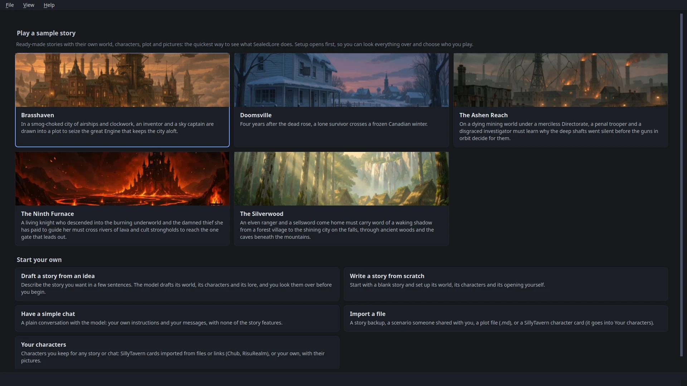
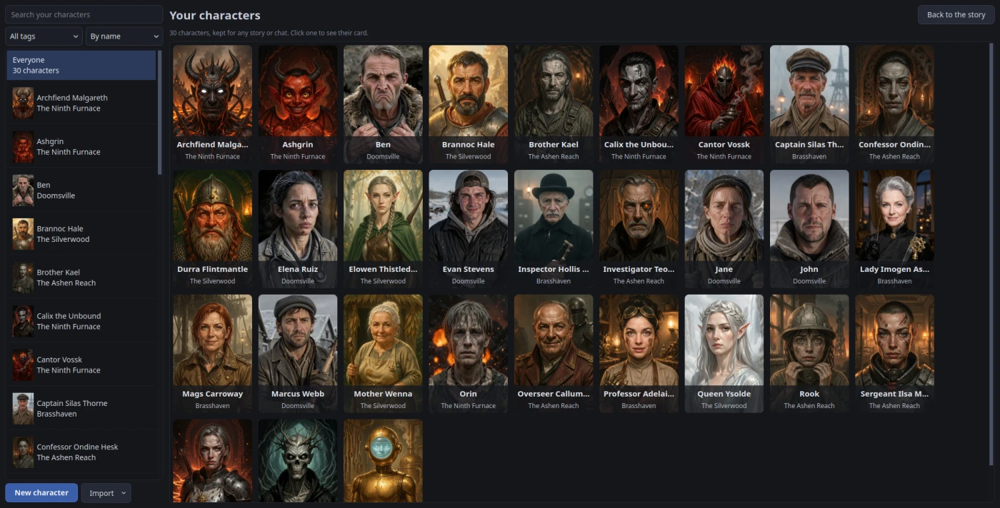

# SealedLore

A Linux and Windows application for AI-driven roleplay with many characters
in an open world, with a number of particularly useful features.



*Beta.* This application has been tested extensively both through
automation and manually by the developer. It is however still in early
public testing, so expect bugs, and there are no guarantees that everything
works as intended. Bug reports and pull requests are welcome; see
[CONTRIBUTING.md](CONTRIBUTING.md). Free software under the AGPL (see
[Licence](#licence)).

### Beta Features Status

Simple Chat is complete and should be a bug free experience. While simple by
design, it offers features useful to basic roleplay chat. Auto summarization,
branching, easy creation of pictures and videos, swapping mid chat to private 
AI models with TEE and E2EE models with Tinfoil, and in memory only chat modes.
All those are working properly and I don't expect many changes to this mode.

Starting a full story from scratch or from a premise is also fully functional
and works well. Most updates to this mode will be improved prompting,
tweaks to features to get better responses and so on. Nothing is broken,
but improvements will come regularly.

Stories with a human authored plot. This also works quite well at the moment,
most improvements here will be related to better integrating the plots into
the story. Making it more natural, more consistent, etc. As above, nothing
is broken, but there are definitely improvements to be made here.

I decided to remove the mapping and Visual Story modes from this app. They
were too experimental and not progressing quickly enough to a playable state.
I plan to release that as an entirely separate game later when it is actually
fun to play. This app will remain focused on text based roleplay.

### New in version 3

- **The cast board, in one place** (3.1.0b2). A story's characters are on
  one page, laid out as Your characters is: **Cast board…** on the People page
  shows everyone down the left, and each one's card and pictures in two tabs
  (the Cast page has gone into it). It says plainly that it is this story's
  own, and Save to Your characters… keeps any of them for other stories. On
  the sheet of looks and expressions, rows and columns stay where you put
  them (drag a heading, or Move up and down), each heading has the words its
  pictures are drawn with ("happy, but reserved, a small smile"), a missing
  picture is a blank place showing what it would be drawn as, and the row for
  pictures set aside is always there.
- **Characters in a simple chat** (3.1.0b2). A chat can have characters for
  their pictures alone: bring them in on the People page or the cast board
  (from Your characters, a new card or a SillyTavern card), choose how each is
  shown, and draw new pictures of them. Nothing about them is sent to the chat's model;
  their pictures go with a picture you ask for, as a story's do.
- **A plot without writing one** (3.1.0b1). The model can write a story's
  plot: made up from the story's world and characters, or from what you
  describe (how many events, how often, how big, how disruptive, what kinds).
  Offered as the last step of Write a story from scratch, when drafting from
  an idea, and in Story → Write a plot with the model…. It stays hidden unless
  you ask to see it. Story → Open in the plot editor… opens a story you
  already have in the plot editor with everything filled in: write its plot,
  change anything else, and save it as a new story, the old one left as it
  is. The editor now shows which parts are the story's and which the plot's.
- **Ask for changes** (3.1.0b1). Once a story is drafted for you, or a plot
  written, say what you'd like different: "I like the world, but I'd prefer
  the characters were more badass", "the world isn't hostile enough". The
  model changes just that, the rest stays as it is, and **Undo the last
  change** takes any request back. A plot stays hidden while it is changed.
- **As much as you want set up** (3.1.0b1). Drafting from an idea asks how
  much world to write (basic, standard or detailed), how many people (a
  handful, standard or lots) and how much about each of them (briefly,
  standard or in depth), and a plot the model writes can bring in a few
  newcomers or many, written briefly or in depth. The draft also sets how
  lively the world is and, when the premise says, how its pictures look.
- **Cast cards that fit** (3.1.0b1). The cast's cards get room in proportion
  to the story's context budget (Settings → Context), and a card past it is
  condensed to about a third of its length instead of being cut to a line.
  Each character's card on the cast board shows its condensed text, to edit
  or have written again.
- **A story's characters, kept** (3.1.0b1). Cast board → Save to Your
  characters… keeps any or all of a story's characters in Your characters,
  linked to the story.
- **Your characters** (3.0.0b1). Every character you keep, in one place
  outside any story (File → Your characters…, or the start page). Import
  SillyTavern cards (PNG, CHARX or JSON files, or a link to Chub or
  RisuRealm) with every field and file they have (a background, the pictures
  their greetings show, sounds), or make your own; give them
  pictures on the cast board's sheet of looks and expressions; keep versions
  of one. Put any of them into a story as you set it up or while you play
  (Cast board → From Your characters…), and keep any or all of a story's
  characters there (Cast board → Save to Your characters…). When a story
  changes them (a new picture, a changed description), their card on the
  cast board says so, and **Changes…** saves the change to their card, makes
  a new version of it, or keeps it in that story only. **Chat with them…** starts a simple chat from their card
  and a greeting of theirs, and **Draft a story with them…** has a story
  drafted around them from your premise. Simple chats keep your favourite
  system prompts (**Saved prompts**). A SillyTavern card imported from File
  now goes into Your characters.



- **Characters with many faces** (3.0.0b1). A character's pictures can be
  labelled with the look they wear (a winter coat, combat armour) and the
  expression of the moment, and the picture that fits is chosen after each
  passage: on the People page, and if you like on a stage under the story and
  beside each passage (View). **The cast board** (**Cast board…** on the
  People page) takes the whole window: every character's card, and their
  pictures as a sheet of looks and expressions, the missing ones drawn in a
  few clicks. Doomsville's John and Jane come in four expressions and three
  looks.


- **A picture style for each story** (3.0.0b1). Gritty and realistic, clean
  and polished sci-fi, glamorous, anime, painted fantasy and more, your own
  words, or the style of a picture you have. Portraits can be head and
  shoulders, upper body or full body, and **Restyle pictures…** redraws
  imported pictures to match.
- **Continue, prompt sets and SillyTavern cards** (3.0.0b1). **Continue** a
  passage from where it stopped, share your prompt edits as a prompt set, and
  bring **SillyTavern** character cards and lorebooks in and out, from a file
  or a link.
- **Every part of a character can be changed** (3.0.0b2). In Your
  characters, a card's lorebook can be edited entry by entry, its files added,
  renamed, retyped or taken off, and every other field it carries changed,
  down to other apps' settings. Export it as changed, for others to use, or
  change a copy and keep the original. A lorebook goes out and comes in
  exactly as SillyTavern itself converts one.
- **Kept safe, and quicker to work with** (3.0.0b2). Back up all of Your
  characters in one file and put them back, here or on another computer,
  with their versions, pictures and links to your stories. Choose several at
  once to delete, export, tag or add to the story; replace a card's file;
  bring in NovelAI, Agnai and RisuAI lorebooks, and move entries up and down.
  A story made from a card's own scenario stays linked to the card. Ctrl+R
  regenerates the latest passage and Ctrl+Shift+Enter continues it, and a key
  that would go over plain http to another machine on your network is asked
  about before it is sent.

### New in version 2

- **Find any story, and give it its own models** (2.5.0b2). The Stories list says
  what kind each story is and when it was started and last played, sorts by
  last played or title, and searches the text of every story. **Story → Setup… →
  Models** gives one story its own models, marked in the list; every other story
  goes with Settings and follows it. The model button in the status bar now
  changes only the open story. Text boxes grow with what you are editing. Phone
  access says when tor reports its own version out of date. On Wayland, closing
  the model list no longer leaves its tooltips over the story.
- **Text only, and steadier** (2.5.0b1). Visual Stories and the map are
  gone (see above); a story or chat played with them before goes on without
  them, and an old Visual Story is listed as one not played here. Each mode
  now keeps to its own: a simple chat's messages are edited with no OOC
  note, what you type and haven't sent stays with its own story or chat, a
  Question in a plot story knows the events your character has seen, and the
  menus show only what the open story or chat can use. Click the spend at the
  bottom right for Usage and cost. A crash as a story's setup opened on
  Hyprland is fixed, and the AppImage is on Qt 6.11.3 and about 15 MB smaller.
- **Pictures of places** (new in 2.0.0b7). A picture of each place the
  story goes to, with nobody in it, kept on the place's lore entry and shown
  behind the story's text while the scene is there. A button above the story
  draws one for the place you are at, or a new one from the last as the place
  is now (the bar after the brawl). The samples come with a picture of each
  of their places. See [Pictures of places](#pictures-of-places) below.
- **A picture kept as a card's own** (new in 2.0.0b7). Right-click any
  picture and choose **Use as a character's picture…** or **Use as a place's
  picture…**: frame the one person, or the place without the people, and keep
  it as their portrait or the place's picture, or have a portrait or a
  picture of the place drawn from the part you framed.
- **Every character with a face.** A portrait for each character, drawn from
  their card when you start, and the People page beside the story shows who
  is here by their faces.
- **New sample stories to start from**, each with a plot, a background and a
  picture of everyone and of every place: The Ashen Reach (grimdark science
  fiction), The Silverwood (fantasy), Brasshaven (steampunk) and The Ninth
  Furnace (a hellscape).
- **A friendlier window.** A start page that shows every way to begin, the
  pages beside the story titled with what they are for, Settings in groups,
  plain names throughout, and room to read.
- **Anthropic's own API**, and several endpoints at once, each with its own
  key.
- **Image models chosen once.** Pick a model, and SealedLore sends its
  editing version whenever a picture goes with the prompt.
- **Play from your phone** (new in 2.0.0b2). Turn on File → Phone access,
  and a phone's Tor Browser can play the stories you share, wherever the
  phone is, through SealedLore's own tor: nothing to set up on your router,
  no port opened. Pair it by scanning a code; its bookmark is its login.
  Text stories and chats, on Linux, for now. See
  [Playing from your phone](docs/manual.md#playing-from-your-phone).
- **Plots that play better** (new in 2.0.0b3). A guide to wording a plot,
  [Writing a plot that plays well](SampleStories/WRITING_PLOTS.md) (also under
  Help), the sample plots reworded where it mattered, and the plot director
  asked far less often.
- **Characters from the start, and a known world's cast** (new in
  2.0.0b4). Write a story from scratch makes your characters on the cards
  themselves, portraits and all, in as much or as little detail as you like. For
  a story set in a world that already exists, **Fill with lore characters…**
  writes cards for its people, the ones you name first.
- **A distrusted root out of the bundle** (2.0.0b5). The AppImage no longer
  trusts emSign ECC Root CA - G3, the eMudhra root whose intermediates were
  found to have recoverable keys in October 2026, and Private Mode's client
  is on Tinfoil's current SDK, checked against NanoGPT's own.
- **Three small fixes from play** (2.0.0b6). The quick setup offers a
  passage length of your own; its other way in is called **Advanced setup…**;
  and a past turn's OOC note is edited with the turn, and goes with a new
  branch from it.

### Pictures of places

A story can keep a picture of each place it goes to: the place itself, as it
is now, with nobody in it. **Picture of this place…** above the story (and
under Story) has the storyteller's prompt writer describe the place the scene
is at, you check the prompt, and the picture is drawn (FLUX.3 Klein by
default, about a cent); it goes on the place's lore entry, made for it if
there is none, and stands behind the story's text while the story is there.
Come back later and the picture is back. When the place has changed (a bar
after a fight, a house after the fire), **New picture of this place…** draws
it again from the last picture, so it is the same place with the change
shown. Every picture stays on the entry and in Media. Settings → Images →
Place pictures turns the background off; the pictures stay.

### Privacy

The "Sealed" in the name refers both to the plots (see below) and to how the
application handles your chats. It fully supports NanoGPT's end-to-end
encrypted private models, as well as their standard TEE models and local
servers. But that alone isn't that special.

What makes it more useful is that you can switch from your usual model to a
private one seamlessly, mid-story, and nothing from the private part reaches
your usual model except a summary you approve.

Let's say you're using Claude Sonnet for your roleplay, as it is one of the
best models for prose. Then your story goes somewhere Sonnet may not handle,
or somewhere you simply want to keep private. At that point you can start a
private scene on an end-to-end encrypted model like GLM 5.3. The private
model picks up the story where it is (if the story is too long for it, your
usual model can first condense it into a summary), and you carry on with the
private model. When you are done, you end the private scene: the private
model summarises it, keeping anything intimate or sensitive vague and safe
for work, and shows you the summary. You can drop it, change it or approve
it, and the approved summary is added to your main story. You then continue
with the smarter model, and all it knows of that part are the key plot
points, without the material that might cause refusals.

A simple chat can do the same: the Private button holds the next part of the
conversation on your private model, and the chat's own model reads only the
summary you approve.

Of NanoGPT's models, the end-to-end encrypted `private/` ones are the
stronger choice. A `TEE/` model's text still passes NanoGPT's gateway in the
clear, and for now some of what its checks should prove can't be checked
through NanoGPT. The app says what fell short on the model button and under
each reply, and refuses the TEE models it can't attest at all.

### Author-driven plots

The "Sealed" in the name also refers to plots written by a person (or, I
suppose, an AI) and kept hidden from the player as they play through them.
Events can trigger under specific circumstances, or at specific times in the
story.

So rather than an AI simply injecting random events to spice up a story, an
actual human can write a plot outline that reacts to what you do. A
secondary AI model follows the story to track when triggers are met: for
example, being at a set place at a set time, or how you respond to a certain
person. Things can also happen off screen: if you fail to meet an objective
by a certain date, a town can be overrun in the background, or a character
you would have met may be dead instead, and consequences may follow. A time
skip or an event you write yourself in a Direction turn moves the plot along
with it.

The plot file editor (File → Plot file editor…) lets you write your own
plots and share them, with reference pictures for their characters, places
and lore if you like (kept in a folder beside the file). It also opens a
story you already have (Story → Open in the plot editor…), everything filled
in, to write its plot or change anything else; saving makes a new story, and
the one you opened stays as it was.

If you'd rather not write one at all, the model can (Story → Write a plot
with the model…, or the last step of a new story): from the story alone, or
from what you tell it you want. The plot it writes is checked the way a plot
file is, and kept hidden from you too unless you choose to look.

### Auto-fix your story

If the AI isn't responding the way you'd like, but you can't work out which
setting needs changing, Story → Review settings with the model… has an AI
model (I recommend Opus 5.5) look over the story's settings, the model
settings and the prompts the storyteller receives. Based on your complaint, it recommends
how to fix it, and you accept or reject each recommendation.

### Character and scene consistency

It's always annoying when characters suddenly appear in a scene out of
nowhere: "listening in", "standing nearby", "listening on the radio". In a
story this is guarded against by the Scene page, which tracks who is where,
and by prompts that testing has shown do a good job of avoiding it without
breaking the story's flow. And the model never speaks or acts for your
character.

### Pictures and video

Every character can have a portrait, and every lore entry a picture, drawn
from what their cards say: the Start dialog offers them when a story begins,
and you see and can change every prompt first. A portrait can then be drawn
again, changed (older, a scar, other clothes) or shown in the scene as the
story stands, keeping the same face. FLUX.3 Klein draws them by default for
about a cent each; Seedream 5.0 Pro draws the best.

You can also have a picture of the current scene: the AI that has read the
story writes the prompt, using those portraits and any other reference
pictures you give people, places and objects. You see the whole request
before anything is sent. I recommend Seedream 5.0 Pro for this, which is the
default. Every picture and video the story has made is on its Media page.

It can make short videos of the story too (Seedance 2.5 by default), played
in place in the story, from a prompt written for video and, if you like,
starting or ending on one of your pictures. Video costs far more than
pictures, so it is off until you give it an API key of its own (Settings →
Video), and every video shows its price and waits for you to accept it.
Pictures and video can each use a different service from chat (NanoGPT,
OpenRouter, WaveSpeed, or anything OpenAI-compatible).

### Simple chat

You can also have a basic chat without the storytelling features, but still
with summarising, end-to-end encrypted models, image generation, and so on.
Start one from any of your characters, their card as its first message, and
keep the system prompts you like to pick again.

### API usage fees

I suggest setting a spending limit on your NanoGPT (or other provider's) API
key. With every feature on, SealedLore calls several models, sometimes
several per turn, so it isn't meant to be a cheaper way to roleplay, but a
better one. That said, most of it can be turned off, and you still keep many
of the features.

Have fun!

## What else it does

- **Playing**: you write as a character you can switch at any time, as
  narration, or as direction to the model; you can also ask it questions out
  of character.
- **People by their faces**: beside the story, who is here now,
  the rest of the cast and the supporting characters, each with their
  portrait; someone the story brings in without a card gets one in a click.
  Label a character's pictures by look and expression and the one that fits
  is shown as the story goes; the cast board has everyone's cards and shows
  all their pictures, gaps and all.
- **A picture style for each story**, ready-made or your own words or taken
  from a picture, with portraits head and shoulders, upper body or full body,
  and pictures redrawn in another style while keeping what they show.
- **The world and the cast**: a world bible, cast sheets with skills,
  supporting characters the story introduces, and a lorebook whose entries
  can wait, unseen by any model, until you mention them, so what hasn't
  happened yet doesn't happen early.
- **Outcomes and dice**: fiat, plausible, contested, or d100 rolls against
  the character's skills.
- **Length and style**: length presets with measured word counts, a per-turn
  override, and a style block you can edit by hand.
- **Long stories**: old prose summarised into chapters in the background and
  merged into parts as the story grows, with a prompt laid out for prompt
  caching. Edit any chapter or rebuild it in the background; ask a Question
  about something long merged and its chapters come back, for the Question
  and the next few turns.
- **Takes and branches**: regenerate any passage in place, carry the latest
  on from where it stops (**Continue**), or rewrite any earlier message as a
  named branch; a diagram shows them all.
- **Drafting**: a whole story drafted from a premise, as briefly or in as
  much detail as you like, around characters of your own if you like.
- **Every prompt yours to change**: File → Prompts (advanced)… shows every
  instruction SealedLore sends to a model, editable for one story or for every
  story, and exports or imports them as a prompt set to share.
- **Your characters**: every character you keep, outside any story, with
  every field of a SillyTavern V3 card and their pictures as a sheet of looks
  and expressions. Put them into any story, and what a story changes of them
  (a new picture, a changed description) goes back to their card, becomes a
  new version of it, or stays in that story; start a simple chat with one, or
  have a story drafted around them from your premise.
- **SillyTavern cards and lorebooks**: import character cards into Your
  characters (a PNG, JSON or CHARX file, or just its link on Chub or
  RisuRealm) with every file they carry, bring a card into a story, and export
  characters and lore for SillyTavern.
- **Costs**: per passage, per session and per story.
- **Routes**: on NanoGPT, choose which host serves each model (the fastest,
  the cheapest, or one you pick), and see whether the choice was followed.
  The storyteller's host can be changed beside its model, mid-story or
  mid-chat.
- **Quick replies**: models are asked to reason as little as they allow by
  default (Settings → Generation, for every story). A model that NanoGPT
  lists as reasoning by default is asked for less from its first request;
  one caught thinking at length anyway is noted under the passage and asked
  for less from then on. When a model gets slow or its writing gets worse, the two checks under
  Help → Model trouble → The model takes too long before it writes… and
  Help → Model trouble → The model's writing has got worse… see whether its
  host is to blame, compare other hosts, and let you switch host or mark a
  bad one.
- **Pictures and videos** of the story in its Media tab, the videos played in
  place, and a line above the story that always says where it is kept and
  which model and route it is on.
- **Chats kept in memory only**, pictures and all, that leave nothing on
  disk unless you export them.

## Installing

### Linux: the AppImage

Download `SealedLore-<version>-x86_64.AppImage` from the
[releases page](https://github.com/DigitalArchon/SealedLore/releases), then:

```bash
chmod +x SealedLore-*-x86_64.AppImage
./SealedLore-*-x86_64.AppImage
```

It needs x86_64 and glibc 2.34 or newer (Ubuntu 22.04, Mint 21, Debian 12,
Fedora 35 and later), with nothing else to install. (Playing videos in the
app uses the PulseAudio client library, which nearly every desktop has.) To
check the download:

```bash
gh attestation verify SealedLore-<version>-x86_64.AppImage --repo DigitalArchon/SealedLore
```

The build is reproducible, so you can also rebuild a release yourself and
compare checksums: see [Building and checking the AppImage](docs/building.md).

The AppImage holds every Python file both as source and compiled, and Python
runs the compiled one. So reading the source inside it tells you what runs
only if the compiled files are what that source compiles to, which
`packaging/appimage/verify_bytecode.sh` checks, offline and without a
rebuild: see [Checking the compiled Python](docs/building.md#checking-the-compiled-python).

### Linux: from source

Python 3.11 or newer, git, Python's venv support and, on an X11 desktop, the
X11 libraries Qt needs. Install them first:

- **Debian, Ubuntu, Mint:**
  `sudo apt install git python3-venv libxcb-cursor0 libxkbcommon-x11-0 libxcb-icccm4 libxcb-keysyms1 libxcb-xkb1`
- **Fedora:** `sudo dnf install git xcb-util-cursor`
- **Arch, CachyOS, Manjaro:** `sudo pacman -S git python xcb-util-cursor`

Then:

```bash
git clone https://github.com/DigitalArchon/SealedLore && cd SealedLore
python3 -m venv .venv
source .venv/bin/activate
pip install -e .
sealedlore-gui
```

If an X11 library is still missing, `sealedlore-gui` says which and how to
install it ([System packages](docs/manual.md#system-packages)). To add it to
your desktop's menu, see [Desktop entry](docs/manual.md#desktop-entry-optional).

### Windows (from source)

Windows 10 or 11. There is no installer yet: open **Windows PowerShell** from
the Start menu and paste these lines one at a time. Close and reopen
PowerShell after the first two, so it finds what they installed.

```powershell
winget install -e --id Python.Python.3.12 --accept-source-agreements --accept-package-agreements
winget install -e --id Git.Git --accept-source-agreements --accept-package-agreements
```

```powershell
git clone https://github.com/DigitalArchon/SealedLore
cd SealedLore
py -3.12 -m venv .venv
.venv\Scripts\python -m pip install -e .
.venv\Scripts\pythonw -m sealedlore.gui.app
```

The manual's [Windows section](docs/manual.md#windows-from-source) goes
through this step by step. It covers installing without winget or Git,
making a desktop shortcut, updating, and what to do if something goes wrong.
Linux is the version SealedLore is built and tested on day to day, and
Windows offers weaker privacy on the machine itself (see
[Your data and privacy](#your-data-and-privacy)).

## First five minutes

1. **Point it at an endpoint.** File → Settings → Endpoints takes a base URL
   and an API key. Any endpoint that speaks the OpenAI `/chat/completions`
   protocol works; the defaults assume [NanoGPT](https://nano-gpt.com)
   (`https://nano-gpt.com/api/v1`), and [OpenRouter](https://openrouter.ai)
   (`https://openrouter.ai/api/v1`) or a local server (on this computer or
   another on your local network, over plain `http://` if it likes) work the
   same way. Anthropic's own API works directly too, with an Anthropic key
   and `https://api.anthropic.com` as the base URL (Settings → Endpoints →
   Speaks reads it from the address). Several endpoints can be set up at
   once, each with its own key, and the model picker's Provider column
   shows which endpoint each model is from. The key is kept in the system
   keychain (GNOME Keyring or
   KWallet on Linux, Credential Manager on Windows), or in plain text in the
   data folder on a computer without one; Settings says which under each key
   field. It is used for nothing else. NanoGPT is the recommended endpoint: it also serves the
   end-to-end encrypted models that private scenes and chats use. Make an
   account at [nano-gpt.com](https://nano-gpt.com/), or through the
   developer's [referral link](https://nano-gpt.com/r/cDT4qL3x). It applies to
   most NanoGPT website and API default route usage, including images and
   video. You get a 5% discount there, and the developer gets credit worth up
   to 10% of it. Until an endpoint, key and story model are set, the window's
   start screen walks through these steps.

2. **Check the story model** on the Models page. It starts as Claude Sonnet
   4.6, which with Opus 5.5 measured best as a storyteller; GLM 5.3 is a good
   cheap one. Browse… lists what the endpoint offers. On NanoGPT the small
   calls made on every turn (the scene, the plot, picking lore) start on
   cheaper models that measured well for them; **Use recommended models**
   fills them in on a setup you already have, and **Test speed…** shows how
   quickly each model you have chosen answers. A field left blank falls back
   to the story model. For a model NanoGPT runs on several hosts, **Route…**
   beside its field can pick the fastest or cheapest host, or one host,
   billed pay-as-you-go (see the manual's Models section).

3. **Start from a sample.** The start page shows the sample stories, each
   with its picture and a line on what it is (File → New… shows them too):
   Doomsville (a survivor at a farmhouse, with a plot), or one of four other
   worlds, each with a plot, a background, and a picture of every character
   and place: The Ashen Reach (grimdark
   science fiction on a dying mining world), The Silverwood (elves, forests,
   caves and a city on a waterfall), Brasshaven (a steampunk city of
   airships and clockwork) and The Ninth Furnace (a hellscape of cultists
   and rivers of lava). Setup opens first; Save, then choose who you are
   playing and the opening is written. Or choose **Draft a story from an
   idea** and describe a story in a sentence or two, or **Write a story from
   scratch**, which walks through it a step at a time, characters and their
   portraits included. Set in a world that already exists? **Fill with lore
   characters…** writes cards for its people.

4. **Play.** Type what your character does or says and press Enter. The
   storyteller answers. Beside the story, **People** shows who is here now,
   by their faces,
   with a portrait drawn for anyone who has none in a click. *Playing* is
   the character you write, *Speaking as* is who a turn's text lands as
   (your character, Narration, Direction to the storyteller, or a Question
   to the model out of character), and **More ▸** has the rest. View →
   Prompt page (advanced) shows exactly what the storyteller was sent.

To look around with no endpoint at all, start it with `--mock`
(`sealedlore-gui --mock`, or the AppImage with `--mock`) and a scripted
storyteller plays instead.

The [manual](docs/manual.md) covers the rest: every part of the window, and
what each feature does.

## Your data and privacy

There is no telemetry, no update check and no crash reporting. Every endpoint
must be `https://` (plain `http://` is accepted only for a server on this
computer or your local network). Phone
access, below, answers phones over `http://` on an onion address, which tor
encrypts the whole way.

- **The chat endpoint** gets every prompt: the world, cast, lore, the recent
  story and your turn, and the side calls made from the story (chapter
  summaries, scene and plot reads, reviews, picture prompts).
- **The embeddings endpoint**, off by default, gets the lore entries, the
  chapters merged into parts (and the archived passages, if recall is set to
  search them), a query built from the last few passages, and your Question
  or turn when recall searches for it.
- **Pictures** go to the picture endpoint (Settings → Images; by default the
  chat endpoint): the prompt you approved and the reference pictures you
  chose.
- **Videos** go to the video endpoint (Settings → Video, off until it has a
  key): the prompt you approved and the start and end pictures you chose.
- **A private scene** goes to the private model alone. Checking a TEE model
  sends the enclave's GPU evidence to NVIDIA and fetches Intel's public
  certificates; nothing from your story goes to either. A `private/` model is
  end-to-end encrypted, so NanoGPT relays only ciphertext.
- **Phone access**, off unless you turn it on, runs SealedLore's own tor,
  which publishes your computer's onion address on the Tor network. Only
  phones you paired get anything, and only from the stories you share. What a
  phone shows may stay on the phone (Tor Browser and Android keep screenshots,
  previews and what the keyboard learns), private scenes and memory-only
  chats included.
- **A card or a lorebook by link** is fetched from its own site (Chub,
  RisuRealm, or wherever the link points), which sees your address as a
  browser would; nothing from your stories goes with it.
- **On disk**, settings and stories live in a data folder only your user
  can read. API keys go to the system keychain, or into that folder's
  `config.json` in plain text where there is no keychain or you choose it. Each story keeps every
  request and reply in its `api_log.jsonl`, so a story backup carries every
  prompt sent for it. An "in memory" private scene keeps its messages off
  the disk (only a content-free record of each call is kept, for the cost);
  an "in memory" chat, on any model, writes nothing at all.
  On Linux the app tells the system to keep no core dump after a crash;
  `crash.log` records only where in the program it happened, never your
  stories.
- **Swap and hibernation** belong to the operating system, on Linux and
  Windows alike: it may write the app's memory, a memory-only scene or chat
  included, to swap or a hibernation file (`pagefile.sys` and `hiberfil.sys`
  on Windows). Disk encryption covers them. On Linux, if privacy is your
  main concern, turn swap off while you use SealedLore with
  `sudo swapoff -a`, and back on afterwards with `sudo swapon -a`. Turning
  it off first moves whatever is already in swap back into memory, which
  needs enough free RAM. Don't hibernate meanwhile.

**On Windows** the network side is the same, but the machine gives less
protection:

- a crash may leave a memory dump with Windows Error Reporting;
- other programs you run can read the app's memory;
- OneDrive may upload exports saved in synced folders.

The app does keep private windows out of screen capture and Recall.

The full account, including what the TEE and end-to-end encryption checks
prove and what they don't, is in the manual:
[Where your data goes](docs/manual.md#where-your-data-goes) and
[Private scenes](docs/manual.md#private-scenes).

## More

- [The manual](docs/manual.md): installing in detail, the window, every
  feature, the terminal client.
- [The plot file format](SampleStories/PLOT_FORMAT.md), with
  [Doomsville](SampleStories/Doomsville.md) as a worked example, and
  [Writing a plot that plays well](SampleStories/WRITING_PLOTS.md), on how
  to word one.
- [Building and checking the AppImage](docs/building.md).
- [Contributing](CONTRIBUTING.md): setting up, running the tests, and how
  the project works.

## Licence

SealedLore is free software under the **GNU Affero General Public License,
version 3 or later** ([LICENSE](LICENSE)). You may use, study, change and
share it. If you distribute it, changed or not, or let people use a changed
version over a network, you must offer them its source under the same
licence. This is a summary: the licence itself is what applies.

Digital Archon, SealedLore's author, can also license SealedLore's own code
on other terms by separate written agreement, for example for use in
software that isn't released under the AGPL. To ask, contact Digital Archon
through <https://www.digitalarchon.com.au>.
Such an agreement covers SealedLore's code only. The third-party software it
uses keeps its own licence, and anyone who ships that software must still
follow its terms. Contributions are accepted under the terms in
[CONTRIBUTING.md](CONTRIBUTING.md), which allow both.

**Third-party software.** SealedLore's dependencies keep their own licences,
all of them compatible with the AGPL. Qt for Python (PySide6) is under the
LGPL-3.0; httpx, pydantic, tiktoken, numpy, tinfoil, keyring and the packages they use
are under permissive licences (MIT, BSD, Apache-2.0, and MPL-2.0 for
certifi). The AppImage lists everything it bundles, with versions, sources
and licence texts, in `usr/share/licenses/sealedlore/THIRD-PARTY-NOTICES.md`
(template: [packaging/appimage/THIRD-PARTY-NOTICES.md](packaging/appimage/THIRD-PARTY-NOTICES.md)).
