# SealedLore manual

Everything the [README](../README.md) leaves out: installing in detail, every
part of the window, and what each feature does. The README's
[First five minutes](../README.md#first-five-minutes) is the quickest way in.

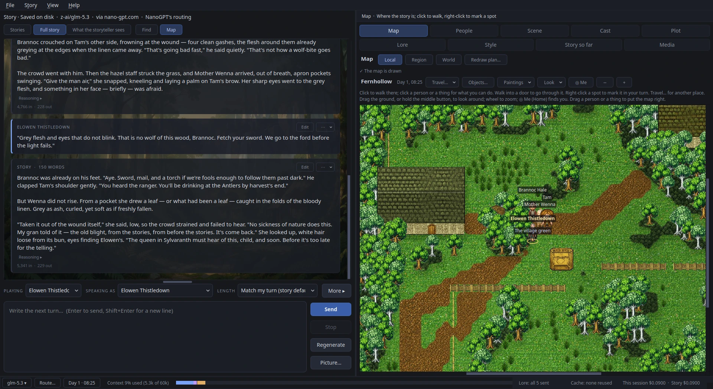

## Contents

- [Features at a glance](#features-at-a-glance)
- [Installing](#installing)
  - [Linux: the AppImage](#linux-the-appimage)
  - [Linux: from source](#linux-from-source)
  - [Windows (from source)](#windows-from-source)
- [Running the app](#running-the-app)
- [Getting around](#getting-around)
- [Models](#models)
- [When a model misbehaves](#when-a-model-misbehaves)
- [Setting up a story](#setting-up-a-story)
- [Drafting a story, and reviewing its settings](#drafting-a-story-and-reviewing-its-settings)
- [Changing the prompts (advanced)](#changing-the-prompts-advanced)
- [Perspective and supporting characters](#perspective-and-supporting-characters)
- [The People page](#the-people-page)
- [The scene, and who can walk into it](#the-scene-and-who-can-walk-into-it)
- [The map](#the-map)
  - [Playing on the map](#playing-on-the-map)
  - [Edit Mode](#edit-mode)
- [Branches, takes and export](#branches-takes-and-export)
- [Outcomes and dice](#outcomes-and-dice)
- [Response length and style](#response-length-and-style)
- [Lore retrieval](#lore-retrieval)
  - [Lore that hasn't happened yet](#lore-that-hasnt-happened-yet)
- [Pictures](#pictures)
  - [Pictures of your own](#pictures-of-your-own)
  - [Pictures for the cards](#pictures-for-the-cards)
- [Videos](#videos)
- [Private scenes](#private-scenes)
- [Simple chat](#simple-chat)
- [Playing from your phone](#playing-from-your-phone)
- [The context budget and archiving](#the-context-budget-and-archiving)
- [The terminal client](#the-terminal-client)
- [Where your data goes](#where-your-data-goes)
  - [On Windows](#on-windows)

## Features at a glance

- **Playing**: you write from inside the story as a character you can switch
  at any time; the model never writes your character, and nobody walks into a
  scene by shortcut. Speaking as a character, as narration or as direction;
  OOC notes; questions to the model out of character.
- **The map**: a story can be played on a map drawn in pixel art for its
  world. Walk anywhere, click people and things for what you can do, travel
  between places; the storyteller is told where everyone stands and who can
  see whom. The open country is designed by the AI ahead of you, region by
  region, as you explore. Places stay where the story put them, what happens shows (a barn
  burning, a thing carried off), floors, decks, weather and the hour show,
  and Edit Mode changes anything by hand: walls, doors, floors, rooms,
  buildings, places and things. A place can be painted by an image model. Tile sets come with the samples, and a new one can be designed for
  your world.
- **Faces**: a portrait for every character and a picture for every lore
  entry, drawn from their cards; an avatar on the map from the portrait; the
  People page shows who is here by their faces.
- **Sample stories**: Doomsville, with or without a map, and four other
  worlds, each with a plot, a map drawn up and furnished, a background and a
  picture of everyone, all on the start page.
- **The world and the cast**: world bible, cast sheets with skills, supporting
  characters the story introduces (suggested, never added by themselves), a
  lorebook sent whole when small and selected per turn when large.
- **The scene keeps itself**: after each passage a small model reads who came
  and went, where the scene moved and whether it is private; the Scene tab
  follows, with Undo. Recent scenes and who was in them stay with the story.
- **Simple chat**: a plain conversation with your own system prompt, with
  branches, pictures and summaries, kept on disk or in memory only; a part
  of it can be held in private on another model, and on a TEE model all of
  it is attested (end-to-end encrypted on a `private/` model).
- **Plots**: a Markdown plot file with facts, places and events; a director
  brings events about at the right moment and a clock keeps story time. A
  form-based editor writes the file for you.
- **Outcomes and dice**: fiat, plausible, contested, or d100 rolls against the
  character's skills, per story and per turn.
- **Length and style**: presets with measured word counts, a per-turn
  override that sticks, and a hand-editable style block.
- **Long stories**: archival into chapter summaries written in the background,
  old chapters merged into parts, an optional fact ledger, and the prompt
  laid out for Anthropic prompt caching through OpenRouter or NanoGPT.
- **Takes and branches**: regenerate any passage (the take swaps in place),
  rewrite any earlier message as a named branch, take a turn back into the
  composer; every take is kept.
- **Pictures**: a prompt written from the story on the story's cached prefix,
  approved before anything is sent, with the cast's reference pictures. Every
  picture and video in one place, the Media page. An image model is chosen
  once: its editing version is sent whenever a picture goes with the prompt.
- **Videos**: a few seconds of the story, from a prompt written for video,
  optionally starting or ending on a picture; its price shown and accepted
  before it is sent, on a key of its own; played in place.
- **Private scenes**: a span of the story played on a local or TEE model
  alone, end-to-end encrypted on NanoGPT's `private/` models, kept on disk
  or in memory only, handed back as a summary you approve.
- **Drafting and review**: a whole story from a premise; a settings review
  that proposes typed changes you tick.
- **From your phone**: play the stories you share from a phone's Tor
  Browser, anywhere, through SealedLore's own tor; paired by scanning a code,
  with nothing to set up on your router. Text stories and chats, on Linux.
- **Costs**: per passage, per session and per story, from the endpoint's own
  figures or the model's listed prices.
- **Endpoints**: any OpenAI-compatible endpoint, Anthropic's own API, and
  several at once, each with its own key.
- **Packaging**: a single-file AppImage; a terminal client for the engine.

## Installing

### Linux: the AppImage

Download `SealedLore-<version>-x86_64.AppImage` from the
[releases page](https://github.com/DigitalArchon/SealedLore/releases), then:

```bash
chmod +x SealedLore-*-x86_64.AppImage
./SealedLore-*-x86_64.AppImage              # the app (takes --mock, --data-dir, --story)
./SealedLore-*-x86_64.AppImage cli list     # the terminal client
```

The AppImage carries its own Python, Qt and the X11 helper libraries that systems often
lack (so no `libxcb-cursor0` install needed). It runs on x86_64 with glibc
2.34 or newer (Ubuntu 22.04, Mint 21, Debian 12, Fedora 35, RHEL 9 and later),
the floor set by PySide6 6.10+. Stories and settings live where they always
do (`$XDG_DATA_HOME/sealedlore`, usually `~/.local/share/sealedlore`), so the
AppImage and an installed copy share them. The sample plot files and their
guides are inside it (Help → Plot format guide and samples opens them),
and so is the tor that phone access runs (see
[Playing from your phone](#playing-from-your-phone)).

If the machine has no FUSE (common in containers, occasionally on minimal
installs), run it with `--appimage-extract-and-run`.

To check a download is what it claims to be, or to build one yourself, see
[Building and checking the AppImage](building.md).

### Linux: from source

Python 3.11 or newer:

```bash
git clone https://github.com/DigitalArchon/SealedLore && cd SealedLore
python3 -m venv .venv
source .venv/bin/activate
pip install -e .
sealedlore-gui
```

To update, run `git pull` and `pip install -e .` again in that folder. Your
stories are kept in the data folder, not here, so updating never touches them.

#### System packages

PySide6's wheels don't bundle `libxcb-cursor`, which Qt 6.5+ requires before
it will load the `xcb` platform plugin. Without it the GUI aborts at startup
with *"Could not load the Qt platform plugin xcb"*. On Debian/Ubuntu/Mint:

```bash
sudo apt-get install -y libxcb-cursor0
```

Wayland sessions don't need it. To check which platform plugin is in play,
run with `QT_QPA_PLATFORM=xcb` or `QT_QPA_PLATFORM=wayland`.

Playing videos uses Qt Multimedia, which needs the PulseAudio client library
(`libpulse0` on Debian/Ubuntu/Mint), present on nearly every desktop. Without
it everything else works, and videos show without a preview and can't be
played in place (their ⋯ menu still opens them in your own player).

Playing from your phone runs tor, which the AppImage brings and a source
install doesn't: install the program (`sudo apt-get install -y tor` on
Debian/Ubuntu/Mint). SealedLore starts its own copy only while phone access
is on, with its own settings, and never uses the tor service your system may
run; you can leave that service disabled.

#### Desktop entry (optional)

The app sets its Wayland app ID to `sealedlore` (under X11 its `WM_CLASS`
class is `SealedLore`, which the entry's `StartupWMClass` names), but without
a matching desktop entry the desktop environment has no name or icon to
attach to it, and Qt logs `Could not register app ID` at startup.

`Exec` has to be an absolute path unless `sealedlore-gui` is on the session
`PATH` — which it won't be when running from a venv. GIO silently refuses to
load an entry whose `Exec` program it can't find, so install it with the path
substituted (run this with the venv active):

```bash
sed "s|^Exec=.*|Exec=$(command -v sealedlore-gui)|" sealedlore.desktop \
  > ~/.local/share/applications/sealedlore.desktop
mkdir -p ~/.local/share/icons/hicolor/scalable/apps
cp packaging/sealedlore.svg ~/.local/share/icons/hicolor/scalable/apps/sealedlore.svg
update-desktop-database ~/.local/share/applications 2>/dev/null || true
```

### Windows (from source)

SealedLore runs on Windows 10 and 11 (and Windows Server 2022). There is no
installer yet, so you set it up by pasting a few lines into PowerShell, a
window where you type commands. You don't need to know anything about it:
every step below says exactly what to paste. It takes about ten minutes and
needs about 1 GB of disk space.

Linux is the version SealedLore is built and tested on day to day. What is
different about privacy on Windows is under [Where your data goes → On Windows](#on-windows).

#### Opening PowerShell

1. Click the **Start** button, type `powershell`, and click **Windows
   PowerShell**. A window with a blinking cursor opens.
2. To run a line from these instructions: copy it, click in the PowerShell
   window, paste it with **Ctrl+V** (or a right-click), and press **Enter**.
   Wait for the blinking cursor to come back before pasting the next line.

#### Step 1: Install Python and Git

SealedLore needs **Python**, the language it is written in. **Git** is
optional, but it makes updating easier later. There are two ways to get them.

**The quick way (winget).** Windows 11 comes with a tool called `winget`
that installs programs for you, and most up-to-date Windows 10 computers
have it too. Paste these two lines into PowerShell, one at a time:

```powershell
winget install -e --id Python.Python.3.12 --accept-source-agreements --accept-package-agreements
winget install -e --id Git.Git --accept-source-agreements --accept-package-agreements
```

If Windows asks whether to allow the app to make changes, click **Yes**.
When both have finished, **close PowerShell and open it again** (see above),
so it finds what was just installed. Then go to Step 2, "With Git".

If PowerShell says `winget` is not recognised, or either line fails, use the
manual way instead.

**The manual way.** This needs no winget, no Git and no administrator
rights.

1. Go to <https://www.python.org/downloads/release/python-31210/>, scroll
   down to **Files**, and click **Windows installer (64-bit)**.
2. Open the file you downloaded. On the first screen of the installer:
   - **untick** "Use admin privileges when installing py.exe" (so it
     doesn't ask for an administrator's password);
   - leave "Add python.exe to PATH" as it is;
   - click **Install Now**, and **Close** when it says it was successful.
3. Go to <https://github.com/DigitalArchon/SealedLore>, click the green
   **Code** button, and click **Download ZIP**.
4. Open your **Downloads** folder, right-click the ZIP file, choose
   **Extract All**, and click **Extract**.
5. Close PowerShell and open it again (see above). Then go to Step 2,
   "Without Git".

#### Step 2: Install SealedLore

**With Git** (the quick way above). Paste these two lines:

```powershell
git clone https://github.com/DigitalArchon/SealedLore
cd SealedLore
```

**Without Git** (the manual way above). The folder you extracted has
another folder inside it with the same name; open folders until you see one
with files called `README` and `pyproject` in it. Then in PowerShell, type
`cd` and a space (don't press Enter yet), **drag that folder from File
Explorer onto the PowerShell window**, and press **Enter**.

**Then, either way**, paste these two lines. The second one downloads what
SealedLore needs and takes a few minutes; a lot of text scrolls past, and
it is finished when the blinking cursor comes back. A note that "a new
release of pip is available" is harmless.

```powershell
py -3.12 -m venv .venv
.venv\Scripts\python -m pip install -e .
```

#### Step 3: Start it, and make a desktop shortcut

Paste this to start SealedLore:

```powershell
.venv\Scripts\pythonw -m sealedlore.gui.app
```

The SealedLore window opens. To connect it to a model, see step 2 of
[First five minutes](../README.md#first-five-minutes).

To put a **SealedLore** shortcut on your desktop, paste this line (it is
long: copy all of it) while PowerShell is still in the SealedLore folder:

```powershell
$s = (New-Object -ComObject WScript.Shell).CreateShortcut("$([Environment]::GetFolderPath('Desktop'))\SealedLore.lnk"); $s.TargetPath = "$PWD\.venv\Scripts\pythonw.exe"; $s.Arguments = "-m sealedlore.gui.app"; $s.WorkingDirectory = "$PWD"; $s.Save()
```

From then on, double-click the shortcut to start SealedLore. You don't need
PowerShell again until you update.

#### Updating

Your stories are not kept in the SealedLore folder (they are in
`%LOCALAPPDATA%\SealedLore`), so updating never touches them.

- **With Git:** open PowerShell and paste these three lines:

  ```powershell
  cd SealedLore
  git pull
  .venv\Scripts\python -m pip install -e .
  ```

- **Without Git:** download and extract the new ZIP as in the manual way,
  then do Step 2 ("Without Git") and Step 3 again in the new folder,
  including the shortcut line, which replaces the old shortcut. You can
  then delete the old folder.

#### If something goes wrong

- **"py is not recognized"**: close PowerShell and open it again. If it
  still says so, Python isn't installed: follow the manual way in Step 1.
- **"winget is not recognized"**: your Windows doesn't have winget. Use
  the manual way in Step 1.
- **Typing `python` opens the Microsoft Store**: that is Windows offering
  its own Python. Close the Store and use the lines above exactly as
  written: they start with `py` or `.venv\Scripts\python`, which never go
  to the Store. Don't install Python from the Store: that version keeps
  SealedLore's files in a hidden folder of its own, not where Help → About
  SealedLore says they are.
- **The shortcut does nothing**: in PowerShell, go to the SealedLore folder
  (as in Step 2) and paste `.venv\Scripts\python -m sealedlore.gui.app`.
  This is the same as the shortcut, but any error is shown in PowerShell.
  Include it if you report the problem.

#### Removing SealedLore

Delete the SealedLore folder and the desktop shortcut. To delete your
stories and settings too, paste `%LOCALAPPDATA%` into File Explorer's
address bar, press Enter, and delete the **SealedLore** folder there.

For developers: there is no need to activate the venv (PowerShell refuses
`Activate.ps1` by default, and calling `.venv\Scripts\python` avoids it);
`pip install -e ".[dev]"` adds the test tools, and
`.venv\Scripts\sealedlore-gui` starts the app with a console beside it.

## Running the app

```bash
sealedlore-gui            # or: sealedlore-gui --mock  (no endpoint needed)
```

Set the base URL and API key under File → Settings → Endpoints, and the model
under File → Settings → Models. `--data-dir` points at an alternative data
directory, `--story <id>` opens one on start, and `--version` prints the
version (Help → About SealedLore shows it too, with the data folder). Until an endpoint is set, anything that would call a model says so
and does nothing.

**Settings** (File → Settings…, Ctrl+,) lists its pages down the left in
groups: **Connection** (Endpoints, Models), **Writing** (Generation, Context,
Lore), **Pictures** (Images, Video) and **Privacy** (Private, Phone). Each page says
at its top what it is for. Options most people never change are put away
under a heading that opens them, such as **Sampling (advanced)** under
Generation, **Prompt caching (advanced)** under Endpoints, **Chapters and
recall (advanced)** under Context, and, under Images, the picture endpoint
for pictures drawn somewhere other than the chat endpoint.

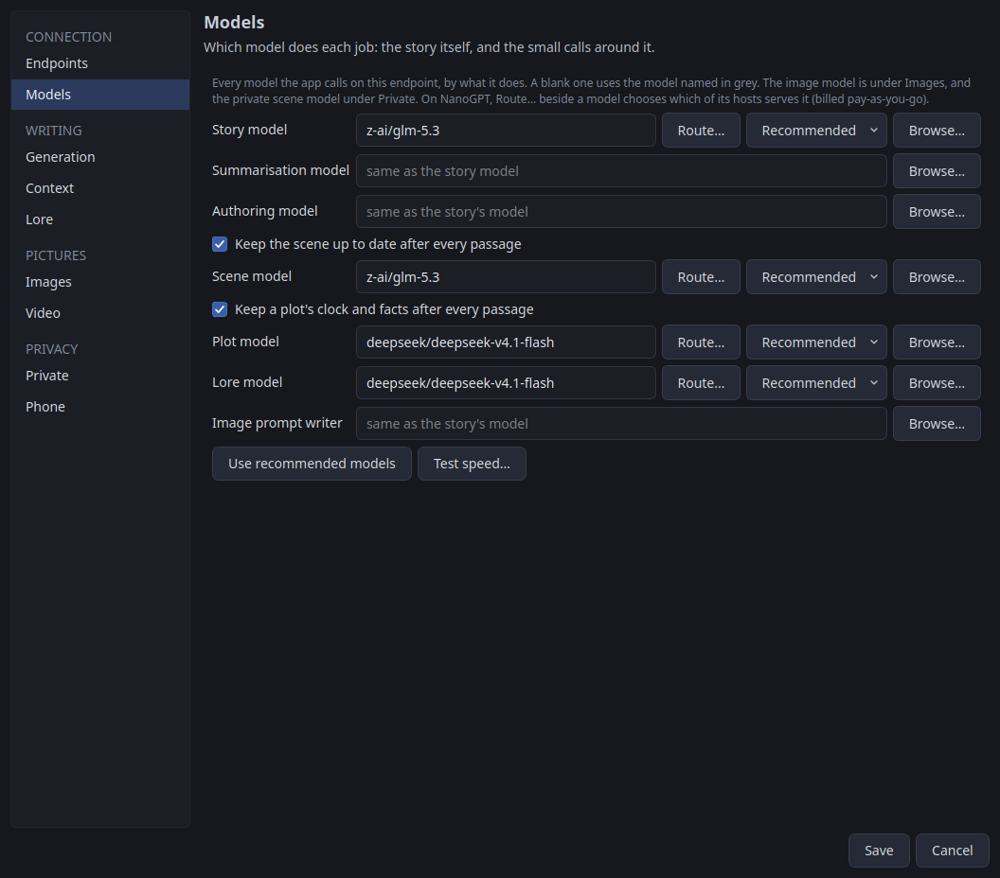

**Several endpoints.** Settings → Endpoints lists every endpoint you have
set up, each with its own address, protocol (**Speaks**) and API key; **Add**
makes another, **Remove** takes one out (its key with it, when you Save), and
**Make default** chooses the one a model named without an endpoint is sent to.
The fields below the list are the selected endpoint's. To use Anthropic's own
API beside NanoGPT: Add, name it `Anthropic`, give it
`https://api.anthropic.com` and your Anthropic key, Save. Browse… on the Models
page then lists both endpoints' models together, with a **Provider** column
saying which endpoint each is from, and the search finds an endpoint's name
too; NanoGPT and Anthropic both serve Claude Opus 5.5, and with a key for
each you choose which row. A model chosen from an endpoint that isn't the
default is written as `Anthropic::claude-opus-5-5`: the endpoint's name, two
colons, the model's id as that endpoint knows it, and the field shows the
endpoint's name beside it, as the model button in the status bar does. A
model named without an endpoint (`anthropic/claude-sonnet-4.6`, as every
field read before this) goes to the default endpoint, so nothing you had set
changes meaning. Each role's model can be on a different endpoint: the
storyteller on Anthropic, the scene read on NanoGPT. Route… applies only to
a model on a NanoGPT endpoint; prices and reasoning facts are kept per
reference, so the same id on two endpoints is two entries. Making another
endpoint the default renames the models on the Models page to keep what
they mean; a story's own model named without an endpoint then means the new
default. A model naming an endpoint you have removed is left as it is and
says so when it is sent. The terminal client adds an endpoint with
`sealedlore configure --endpoint-name Anthropic --base-url
https://api.anthropic.com --api-key …`.

**The defaults assume NanoGPT.** The base URL, the lore picker's model
(`deepseek/deepseek-v4.1-flash`), the Jev decision model, the image model
(Seedream), and the `TEE/` and `private/` private models, are NanoGPT's. On OpenRouter or
another endpoint the chat model works as it is; set the lore, scene, plot and
image models to ones your endpoint lists (Browse… shows them), or the calls
that use them fail and fall back where they can.

**Anthropic's own API.** With an Anthropic key, set an endpoint's base URL
under Settings → Endpoints to `https://api.anthropic.com` (the default one,
or one added beside NanoGPT, above): **Speaks** reads the
protocol from the address, or choose **Anthropic** there outright for a
proxy that speaks Anthropic's Messages API elsewhere. The key is sent as
Anthropic's `x-api-key` header, and the note under the key field says so.
Models are Anthropic's own ids (`claude-sonnet-4-6`, `claude-opus-5-5`;
Browse… lists them), so set the story model to one of them: NanoGPT's
default, `anthropic/claude-sonnet-4.6`, isn't a name Anthropic knows.
Prompt caching works as on NanoGPT, and every model field falls back to the
story model as usual. What differs: every call is
**unpriced**, since Anthropic lists no prices, so the story's cost shows
calls rather than dollars; pictures, videos and embeddings are not
Anthropic's to make, so Settings → Images, Video and Lore need endpoints
of their own (with none, lore is matched by keywords alone); and thinking
follows the reasoning levels under Settings → Generation (As low as
possible sends nothing to a model that thinks only when asked, and the
lowest effort to one whose thinking can't be turned off, such as Opus 5.5).
NanoGPT's routes and private models don't apply.

**Choosing a model.** Every model field has a **Browse…** button. It lists the
models your endpoint offers, fetched from the endpoint itself, and the list is
searchable ("sonnet 4.6", "llama 70b") and sortable by context size or price.
The model name in the status bar does the same for the open story, in one
click. You can still type an id by hand. The image model (Settings → Images,
and the picture dialog) has the same list for image models: search by name,
description or size ("seedream", "4k", "edit"), sortable by price, with how
many reference pictures each takes. The Privacy column says which models are
end-to-end encrypted and which are TEE only. Selecting a TEE model that also
comes end-to-end encrypted offers the encrypted version in one click, and
searching "tee" or "private" lists both. A TEE chat's model button lists only
the models it may move to.

**The start page.** With no story open, the window shows every way to begin,
each with a line on what it does: the stories you played last, to pick up
where you left off; **Draft a story from an idea**, **Write a story from
scratch**, **Have a simple chat** and **Import a file**; and the sample
stories, each with its picture. **File → New…** (Ctrl+N), and **New…** under
the Stories list, show the same choices. A story saves itself as you go
(Ctrl+S saves at once).


**Managing stories.** Right-click a story in the Stories list:
- **Open folder** shows the story's files in your file manager (also for a
  story that can't be read).
- **Duplicate settings only** makes a new, unplayed story with the same world,
  cast, lore, style and opening.
- **Duplicate entire story** copies everything: every branch, summary and
  question, and its cost history.
- **Delete…** moves it to the desktop's Trash, so it can be restored. The Delete
  key does the same.

In the terminal: `sealedlore duplicate <id> [--settings-only]` and
`sealedlore delete <id>`, which deletes permanently after you confirm.

**File → Close story** (Ctrl+W) goes back to the start page. A chat or a
private scene kept in memory only asks first, because closing it loses it.

Anything that runs as a job of its own shows a progress dialog with a
**Stop** button: a settings review, skill suggestions, a character scan,
archiving, rebuilding summaries.

## Getting around

- **Left dock**: the Stories list (right-click for Open folder, Duplicate and
  Delete). It is put away while a story or chat is open, to give the story
  the room; **Stories**, above the transcript, or View → Stories list brings
  it back, and it then stays until you put it away again. With nothing open
  it is always there, once you have a story (before that the start page is
  the way in).
- The docks share the window's width as it changes size, until you drag the
  line between a dock and the story; from then on their widths are yours.
  The window's size and those widths are kept for the next launch.
- **Above the transcript**, a line always says how the open story or chat is
  set up: a story or a simple chat, saved on disk or **in memory only, not
  saved**, its model and how private that is, the endpoint, the route, and a
  private scene when one is open. Hover over it for the whole of it,
  including, for a story, every other call's model and route. It can't be
  changed there; it is only for reference.
- **Above the transcript**: **Find**; **Map**, the map of the story, for a
  story that keeps one (see "The map"); and on the right, once a story has
  more than one branch, **Branch** names the branch you are reading: its menu
  switches to another, renames or deletes it, and **Branches** shows every
  branch at once.
- **Right dock**, beside the story (away while no story is open), its pages
  as two rows of buttons, its title naming the page shown and what it is for: **Map**
  (for a story that keeps one, and the page it opens on), **People** (who is
  in the story, by their faces; the page a story without a map opens on: see
  "The People page"), **Scene** (who is here and where the story is, to
  correct), **Cast** (sheets, skills, supporting characters), **Plot** (the
  clock, facts and events; shown only for a story with a plot), **Lore**,
  **Style**, **Story so far** (the chapter summaries: edit, rebuild, archive
  now; double-click one to go to it in the story) and **Media** (every
  picture and video the story has made, its background and the map's
  paintings and avatars). **View → Prompt page (advanced)** adds **Prompt**: exactly what the
  storyteller was sent last turn, for checking the model's work; **Copy
  prompt** copies it as readable text, **Copy request JSON** as the exact
  request body.

  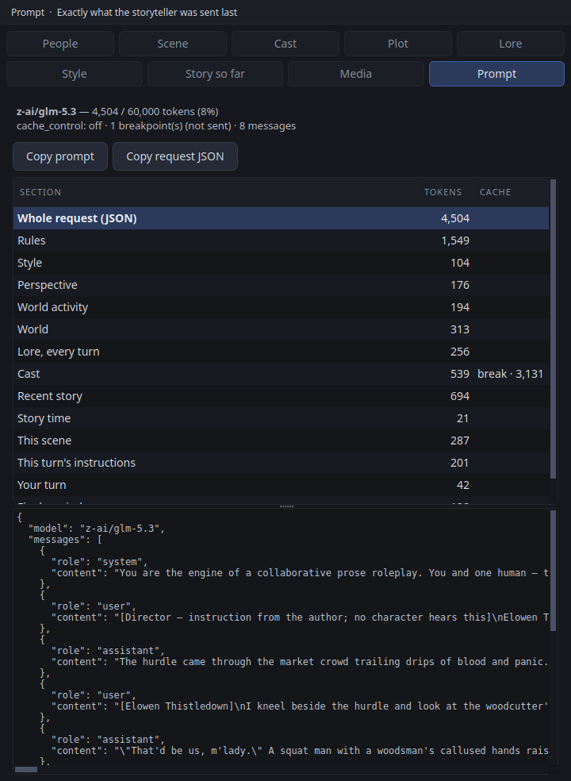

- **Find** (above the transcript, View → Find in story…, or Ctrl+F) searches
  the branch you are reading, older messages included. It starts at the most
  recent match; **Enter** (or ↑ Earlier) goes back through the story,
  Shift+Enter (↓ Later) forward, and Esc closes it.
- **A long story** shows about a hundred messages at a time around where you
  are reading, so going anywhere in it is quick. Scrolling up or down brings
  in the next part as you reach it; the rows at the top and bottom say how
  many messages lie beyond, with **Start of story** and **Latest** to jump to
  either end. Sending a turn always takes you back to the latest.
- **Above the transcript**: *Full story* shows every message; *What the
  storyteller sees* shows the chapter summaries standing in for archived
  prose and marks anything left out for budget (View → What the storyteller
  sees, Ctrl+Shift+V).
- **Each message** has Edit and a ⋯ menu: Regenerate this passage, Take back
  this turn (your turns), Reroll the dice, Use as evidence in a review,
  Illustrate this passage…, New branch from here…, and Delete from here….
- **Markdown in a message is shown as it reads**, in stories, simple chats,
  Questions and chapter summaries alike: **bold**, *italics*, headings,
  lists, quotes, code, tables and rules, with each line break kept where it
  was written. HTML in a message is shown as text, a picture by its
  description, and a link as its words with the address after them; nothing
  in a message opens or loads anything. Edit shows the text as written, and
  Find searches the text as you see it.
- **Text size**: View → Text size → Larger (Ctrl++) and Smaller (Ctrl+-)
  change every piece of text in the window, the story, the panels, the menus
  and the map, from 90% to 200%; the same menu lists the sizes, and Normal
  size (Ctrl+0) goes back. It is kept for next time.
- **Theme and fonts**: View → Theme → Dark is the app's own look, and
  View → Theme → High contrast is white on black, every control outlined,
  yellow for focus and what is current. View → Fonts… picks the font for the window, for the
  story (passages, turns and the boxes you write them in) and for the
  monospace Prompt tab; Restore Defaults goes back to the app's own. Both are
  kept for next time.
- **The composer**: *Playing* is the character you write (the storyteller
  never writes them); *Speaking as* is who your text lands as (that
  character, Narration, Direction, or a Question to the model); *Length* is
  how long the passages are. **More ▸** opens the rest: *Model voices* (who
  the storyteller may voice this turn), *Outcome* (and the dice), **Private**
  (a private scene) and **OOC** (an out-of-character note). It stays open or
  closed as you leave it, opens by itself while a private scene, a roll or an
  OOC note is in use, and names an outcome or voices you chose beside it
  while closed.
- **Make room to read and write.** Drag the line between the story and the
  composer to make the box you type in taller or shorter; it stays as you
  leave it. Text boxes grow with what you write in them, the columns of
  every table can be dragged wider or narrower, and dialogs open at a size
  that suits your screen.
- **The status bar** says how full the storyteller's context is ("Context 4%
  used"), how much of the last prompt the endpoint's cache reused, and what
  the session and the whole story have cost; hover over any of them for the
  exact numbers. Notices show there for a few seconds as SealedLore works.
  Anything that went wrong (a read after a passage that failed, chapters
  that couldn't be written or used, a lore pick that failed) is also kept
  under the message it is about, marked ⚠, so it is still there once the
  next notice has replaced it. A read after a passage that takes a while
  counts up ("Reading the scene with … 45 s; Stop skips it"): Stop then
  skips the reads, the passage stays, and the scene, the clock or the map
  stays as it was.
- **Shortcuts**: Enter sends, Shift+Enter is a new line, Ctrl+Enter sends
  from anywhere, Esc stops, Ctrl+N new, Ctrl+O import, Ctrl+S save,
  Ctrl+, settings, Ctrl+Shift+I picture, Ctrl+Shift+V the transcript view,
  Ctrl+Q quit.

## Models

Nineteen settings name a model; the text models are together on Settings →
Models, the picture models on Settings → Images. Blank ones fall back as
shown; the defaults marked ★ are NanoGPT model ids, so on another endpoint
set them to one it lists (Browse…).

| Setting | Where | Used for | Blank means |
|---|---|---|---|
| Story model | Settings → Models | the story model for new stories | starts as `anthropic/claude-sonnet-4.6` |
| This story's model | the status-bar model button | this story's storyteller | Settings → Models → Story model |
| Summarisation model | Settings → Models | chapters, merges, for every story (and the open one, when changed with it open) | the story model |
| Scene model | Settings → Models | the scene read after each passage, and a plot's clock and facts | the summarisation model |
| Plot model | Settings → Models | the plot's director (the clock and facts are read by the scene model) | the scene model |
| Authoring model | Settings → Models | drafting from a premise, settings reviews | the story model |
| Lore model ★ | Settings → Models | picking lore for a large lorebook | the scene model |
| Map model | Settings → Models | reading each passage for the map: places, who is where, things | the scene model |
| Map art model | Settings → Models | the map's plans and land, and furnishing its buildings | the map model |
| World designer model | Settings → Models | designing the country ahead of the player, a region at a time | the story model |
| Image prompt writer | Settings → Models, or the Image dialog | writing the picture's prompt | the story model |
| Jev model ★ | `config.json` only | "Jev before each turn" | — |
| Image model ★ | Settings → Images | pictures of the story | starts as Seedream 5.0 Pro |
| Portrait model ★ | Settings → Images | portraits and the cards' pictures | starts as FLUX.3 Klein |
| Map picture model ★ | Settings → Images | every picture the map wants: avatars (from the portraits), things, roofs and ground, a tile set of your own, postcards and the Region map's pictures | starts as FLUX.3 Klein |
| Painting model ★ | Settings → Images | paintings of a place on the map | starts as FLUX.3 Klein |
| Video model ★ | Settings → Video | videos | starts as Seedance 2.5 |
| Tile set designer | **Designed by** in the tile set designer (Look → Tile sets… → Design a new set…) | designing a tile set for your world | Claude Opus 5.5 on NanoGPT, else the map art model |
| Private model | Settings → Private | private scenes | — |
| Embeddings model | Settings → Lore | lore vectors | `BAAI/bge-m3` |

A model's reasoning is kept with its passage for you to read, and is never
sent back: no later request, to any model, carries it.

**How much models reason.** Settings → Generation holds the settings for
every story: temperature, max tokens and the rest for the story model, and
how much to ask models to reason, once for the story model's passages and
questions and once for every other call (the scene and plot reads, chapters,
the review, drafts, the picture prompt writer). Both start at **As low as
possible**, which is also the fastest:

- A model that reasons only when asked (Claude Sonnet 4.6, DeepSeek) is
  asked for nothing. Asking such a model for "low" would switch its
  thinking on.
- On NanoGPT, which says what each model does when it isn't told, a model
  that reasons by default (Kimi K3 and Opus 5.5, for example) is asked for
  its lowest level from the first request, even when that is already its
  default (GLM 5.3: left to itself it once reasoned far past it). The note under the story model's
  setting says what that model does left to itself, once SealedLore has
  read it.
- A model that reasons at length anyway is caught doing it, and asked for
  its lowest level from then on. When that happens a note under the
  passage says so, since that reply may have been slow to start (Kimi K3
  thought for 25 seconds at its own default, and 5 at its lowest), and
  Settings → Generation lists the models caught. The check is repeated a
  week later, in case the model has changed.
- TEE and end-to-end encrypted models start at their lowest level.

**Low**, **Medium**, **High** and **Max** ask for that much, mapped to the
nearest level the model offers; the note under each setting says what the
story model will be sent.

**Recommended models.** Left blank, the scene and plot models fall back to the
story model, the most expensive place to run a small call on every turn. On
NanoGPT a new setup starts with the ones that measured best, and Settings →
Models has **Use recommended models** to fill them in on a setup you already
have (nothing changes until you press Save). **Recommended** beside the story,
scene, plot, lore, map and map art fields lists the models measured for that
job, the recommended one first, each with a note on roughly what it scored
and what it costs (for the story, Claude Opus 5.5 as the premium choice: the
better writer on every blind judge, at about 2.4 times Sonnet's price, with
passages twice as long on the map). Choosing one only fills in the field.

| For | Model | Why |
|---|---|---|
| Scene | `z-ai/glm-5.3` | The read needs a model that reasons: about 89 rosters of 94 right on judged reads, where models that don't reason got 72-78. Included in a NanoGPT subscription |
| Plot | `deepseek/deepseek-v4.1-flash` | As sound a director as any tried (3 wrong answers in 138 to both judges), about 2.5 seconds before a passage, and included in the subscription |
| Lore | `deepseek/deepseek-v4.1-flash` | Picks the lore a turn needs after each passage; with 100 entries it cut contradictions of the lore from about 10 in 32 passages to a few |
| Map | `deepseek/deepseek-v4.1-flash` | The quickest map read by three times (under 2 seconds), included in the subscription. GLM 5.3 and Kimi K3 were judged a little more accurate |
| Map art | `z-ai/glm-5.3-flash` | Its drawn areas were ranked first by both blind judges, and it is included in the subscription |

They are NanoGPT model ids. On another endpoint the fields stay blank: choose
a model that reasons for the scene and a quick one for the plot (Browse…).

**How fast is each one?** Settings → Models has **Test speed…**. It sends every
model named there, and the private model, one short request, all at the same
time, asking each for the reasoning its setting asks for in play, and shows for
each:

- **First word**: the wait before its answer begins, any reasoning included,
  since that is the wait you sit through.
- **Tokens a second**: how fast the answer itself is then written, from its
  first word to its last. A model that thinks for a long time and then writes
  quickly is slow in the first and fast in this one.
- **In all**: the whole request, start to finish.

The notes say how long the answer took and how long the model reasoned. A
model used for several things is tested once, and an end-to-end encrypted
model's enclave is attested before anything is timed. It uses the fields as
they stand, so you can try a model before saving it. Each test costs a few
hundred tokens (more for a model that reasons). Speeds change with the hour
and the endpoint's load, and one short answer is a small sample: run it a few
times before choosing between models that are close.

**Which host serves a model (routes).** On NanoGPT most open models (GLM,
DeepSeek, Kimi and the like) run on several hosts, and NanoGPT picks one; on
the subscription, usually the cheapest at FP8 precision or better. The model
list's **Hosts** column says how many a model has. For a model with two or
more, **Route…** beside its field (or **Choose a route…** in the model list)
picks for you:

- **Subscription routing**: NanoGPT's own choice, as before.
- **Fastest first word**, **Fastest overall** or **Cheapest**.
- **A specific host**, from a table of each host's precision, privacy terms,
  NanoGPT's measured first token and speed, prices and caching. It is a
  preference: if that host is down, another serves the call.

**FP8 or better**, ticked by default, leaves out hosts running the model at
lower precision, or whose precision isn't listed (they are hidden from the
table while it is ticked).

**Was the route followed?** NanoGPT's replies don't name their host, so each
routed call's bill is the evidence, and the status bar shows it at the
bottom left once a routed call has come back: **⚡ routes** when they were
followed, **⚠ route not followed** when not. Its tooltip gives each route's
roles, model, last call and why. Nothing billed means NanoGPT served the call
on its own subscription routing instead (it does this without a word when a
chosen host is down); a bill at a clearly different price than the chosen
host's means another host served it. **Any route but the
subscription's is billed pay-as-you-go, even for a model the subscription
includes.** The scene read is where a route pays most: on the fastest first
word at FP8 or better it answered in about a third of the time, as
accurately, for a fraction of a cent a read. Without the precision floor it
was slower and less accurate.

Each role has its own route, so a free storyteller and a fast paid scene read
can be the same model. A simple chat's route is chosen with its model in New
simple chat, and belongs to that chat. The storyteller's route, a story's or
a chat's, can also be changed at the bottom left, beside the model (a host
that keeps failing, say). Routes never apply to `TEE/` or
`private/` models, whose enclave is their host. Test speed… measures each
role on its route, so the same model on two routes shows as two rows. Each
host's privacy terms are its own; on NanoGPT's site your account can require
hosts that keep nothing, which then applies to every route.

## When a model misbehaves

NanoGPT runs most open models on several hosts, and they don't all behave
alike: one may be overloaded, one may have the model think far longer than
it should whatever you ask, and some serve a model at lower precision than
they claim. Hosts come and go, so SealedLore doesn't keep a list of good and
bad ones. Instead, the **Model trouble** menu under Help has two checks you
can run when something seems wrong.

**Help → Model trouble → The model takes too long before it writes…**
Choose which model to check (the story model, or the one behind the scene
read, the plot and so on). It sends the same prompt to your current route and
a few other hosts. Whenever any host keeps nothing it is given, only those are
ticked to begin with: the model maker's own if it is one, then the cheapest at
FP8 or better, since those are what NanoGPT's routing picks. Each gets three
runs, since one reply can mislead. The list shows the ticked hosts first and
sorts by any column you click; tick others as you like, and choose between a
built-in test prompt (nothing of yours) and your story's last prompt. The
results sort the same way, the quickest first. The report says which it is:

- **The host reasons far more than the others**: it has the model think at
  length whatever it's asked. Another host is better.
- **The host is slow but reasons like the others**: it's overloaded.
- **Every host reasons at length**: it's the model. A lower reasoning level
  in Settings → Generation may help.
- **Your route is as quick as the others**: the wait is likely your prompt.
  Run the check again with it.

**Help → Model trouble → The model's writing has got worse…** sends your
story's last prompt to your current route and a few other hosts, once each,
chosen the same way (hosts that keep nothing, ticked first). The replies are
shown side by side with
the hosts hidden (Reply A, B, C…) until you pick the one you like best or
press **Reveal hosts**.

In both, **Use this host** sends that model's calls to the host from now on (a
route, as Route… beside the model sets it), and **Mark as bad…** keeps a
host from ever being offered when you choose one by hand. The route dialog
shows it greyed with your reason, and **Allow again** takes the mark off.
Marking a host bad doesn't stop NanoGPT's own routing from using it: asking
NanoGPT to avoid a host bills the call pay-as-you-go, even on the
subscription.

What each check costs is shown before you run it: every host you pick is
billed pay-as-you-go, even for a model your subscription includes. Your
story's prompt only goes out after a warning saying how much of it there is
and which hosts keep prompts. In a memory-only chat the warning also says that
the hosts are not bound by that: the conversation will then exist on their
servers. A private scene's prompt, or a TEE or encrypted model's, never goes
to another host. Those models usually have one host, so the check offers
their equally private alternatives on the built-in prompt instead, or says
that trying other hosts would mean playing outside private mode.

## Setting up a story

**Write a story from scratch** (on the start page, or File → New…) walks
through what a story needs to begin, a step at a time: its title and world
(and whether it keeps a map), who you play and anyone else to start with,
where it begins and what happens first, and the person, tense and length it
is told in. **Create the story** then goes straight to Start, which asks who
you play and offers portraits for the characters before the opening is
written. Everything else keeps its default and is in Setup and on the Cast
page; **Skip to the full setup…** makes the story with what you have filled in
and opens Setup instead.

**Story → Setup…** holds what a story is built on:
- **World**: the setting and its rules, sent with every turn and cached;
- **Style**: length, perspective, person, tense and the rest, the same form as
  the Style page beside the story, so a new story's opening is written the way
  you want it;
- **Opening**: notes the model writes up, or a passage used as written. Write
  it in the person and tense the story is told in: the first passages take
  their voice from it;
- **Starting scene**: where the story begins, who is there, and which
  character to suggest playing. By default the opening decides who is there
  (the people at their posts, whoever the place would have); set someone to
  **Present** or **Not present** to decide it yourself. Anyone not there can
  still come in later.

**Story → Start story…** asks who you're playing and who is there at the start
(the same choice as Setup's, so a new story can have its cast made first), and
runs the opening, so your first turn is in character.

The opening and starting scene are where a story *begins*. To change how a
story already under way began (say, the other character is the one stranded),
edit them in Setup and save: it offers to start a new playthrough from them,
and the story so far is kept as it is.

A **scenario** is that setup, plus the cast and supporting characters, lore,
style, plot, outcome mode, world activity, picture style and reference
pictures, in one file with no playthrough in it:
- **Story → Export → Scenario…** writes the current story's setup to a file;
- **File → Import…** starts a new story from one, opening Setup first so you
  can change anything (the style above all) before its opening is written;
  Start follows once you save, and Cancel keeps it unbegun;
- **Story → Restart as new playthrough…** starts over from the current story's
  setup without a file, opening Setup first in the same way.

From the terminal: `sealedlore scenario export <id> <file>`,
`sealedlore scenario import <file>`, then `/begin <name>` in the chat.

A **plot file** is a scenario written as Markdown, with a plot as well: the
facts the story keeps and the events a director brings about
([`SampleStories/PLOT_FORMAT.md`](../SampleStories/PLOT_FORMAT.md); `Doomsville.md` is a worked example). The Plot page shows the story clock, the facts as they
stand, and, with spoilers on, the events still to come.

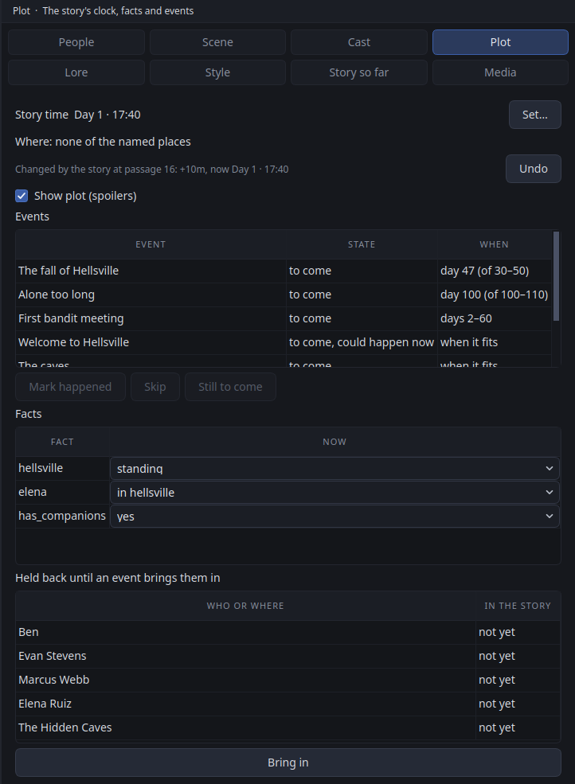

**File → Import…** takes a plot file too. The sample stories that come with
SealedLore (every plot file in `SampleStories/` but the two guides) are
on the start page and in **File → New…**, in the AppImage as well, each with
its picture and its line: Doomsville there is the same as importing
`Doomsville.md`, and **Doomsville with a map** is the same story with a map
drawn up beforehand (a `# Map` section: see "The map"). The Ashen Reach,
The Silverwood, Brasshaven and The Ninth Furnace show other kinds of world
(grimdark science fiction, traditional fantasy, steampunk and a hellscape),
each with a plot, a map drawn up and furnished, every thing and character
drawn, a
background picture, and a picture of every card. Rather than
write the format by hand, **File → Plot file editor…** writes it for you: the
world, opening, characters, places, lore, facts and events each get a form,
conditions and what an event brings or sets are picked from what the file
already has, and the problems list at the bottom is exactly what the importer
would say, each against the item to fix. Characters, places and lore entries
can be given reference pictures there (**Add…** under Pictures): they are
kept in a `pictures` folder beside the plot file, so share the folder with
the file, and are put on the cards when the file is imported. It needs no story open; the editor's
own **Start a story from this file** (its File menu) saves and imports in one
go.

How a plot is worded matters as much as what is in it: a trigger the
director can't judge from a passage waits for good, a watched fact with a
loose meaning flips on the first stranger, an aftermath that fits one outcome
is told as fact after the other. **Help → Writing a plot that plays well**
(also in the plot file editor's Help menu, beside the format guide) opens
[`SampleStories/WRITING_PLOTS.md`](../SampleStories/WRITING_PLOTS.md): what
each part of a plot is read by, and how to word it, with good and bad
examples in the style of the samples.

## Drafting a story, and reviewing its settings

**Draft a story from an idea** (on the start page, or File → New…).
Describe the story you want: the setting,
who you'll play, the tone, and choose the **Person** and **Tense** it is told
in (or leave them to the premise), so the opening is written that way. The
model drafts everything in one go:
- the world;
- a small cast with sheets and skills, plus supporting cards (canon characters
  get a one-liner, since the model already knows them);
- lore entries;
- the opening and the starting scene;
- the style.

It opens in Setup for you to read and change, the style included, and Start
asks who you're playing once you save; Cancel keeps the draft without beginning
it (Story → Start story… when it's ready). Anything
the draft got wrong that couldn't be used (a made-up skill tier, a scene naming
someone not in the cast) is listed rather than guessed at.

**Story → Review settings with the model…** Say what isn't working, for
example "too much action, not enough dialogue". The model reviews the story's settings (world,
style, cast and supporting characters, lore, outcome mode, world activity,
the models and the budget, with your generation settings) and the instructions the
storyteller actually receives. You choose how many exchanges
from the story it sees as examples, from none to all of them: each is your turn
and the reply to it. By default it sees the last three. The dialog shows about
how many tokens that is, and a review too big for the model is refused before
anything is sent. It then proposes changes one setting at a time, each with
what it replaces and why. You tick the ones to apply; the story so far is never
touched. Anything settings can't fix is listed separately. That includes
requests that would break the two rules SealedLore never bends: the model never
writes your character, and nobody gets into a scene by a shortcut.

It may also propose changes to SealedLore's own texts for this story (see
"Changing the prompts" below): the storyteller's rules, its per-turn
instructions and the final reminder. These are about 5,000 tokens more on
each review. Tick **Let it change the side calls' prompts too** to offer it
the rest (the scene read, the plot, chapters and so on), about 10,000 more.
It may reword the texts that carry the two rules, never weaken them. A
proposal that leaves out a placeholder, or drops much of the text, starts
unticked with a warning.

Tick **Send the whole prompt the storyteller receives** to give the reviewer
everything the storyteller gets on its next turn, not just the system prompt.
That includes the chapter summaries, the recent story, and the per-turn
instructions at the end. What it finds wrong with SealedLore beyond this story
(a default that works against any story, behaviour no text controls) comes
back as **Findings about SealedLore itself**. **Copy
review** puts the whole review, findings included, on the clipboard as
Markdown, ready to report. **Story → Last review…** shows it again, and
**Undo review changes** puts the settings back.

The review also sees the storyteller's model and the Generation settings. It
gets the model's context size, output limit and price from your endpoint, so
it can suggest "temperature 1.8 is why replies wander; try 1.0", or a different
model when the complaint is about what the model can manage. Generation
settings are yours for every story, so those are shown as suggestions with no
box to tick: change them in Settings → Generation if you agree. A suggested model
has to be one your endpoint actually lists. A custom length is always proposed
as its wording, which selects Custom by itself. Changes that a hand-written
style block would ignore aren't offered.

Both work before the first turn, so the quickest way to refine a draft is to
review it: "make the world darker", "add a rival".

Both use the **authoring model** (Settings → Models), which defaults to your
chat model. These are occasional calls the whole story rests on, so a stronger
model can be worth it here, such as Opus 5.5 (`anthropic/claude-opus-5.5`); you can also
change it in each dialog. The story is still played with your chat model. Both
calls count toward the story's cost. The Style tab's **Other notes** field is
where plain-words style requests go ("let the narration show what other
characters are thinking").

In the terminal: `sealedlore generate "<premise>" [--model M]`, and `/review
<complaint>` in the chat, which prints the proposals; apply them in the app.

## Changing the prompts (advanced)

**File → Prompts (advanced)…** shows every instruction SealedLore sends to a
model and lets you change any of them: the storyteller's rules, what it is
told each turn (the scene's roster, the directives, the final REMEMBER line),
and every call made around it (the scene read, the plot's director and clock,
chapters and the ledger, lore choice, private scenes, simple chats, picture
prompts, drafting and the settings review). They are grouped, and the search
finds a text by its name, what it does, or its words.

- **For this story, or for every story.** An edit for one story is kept with
  it (and travels in its scenario file, Restart and Duplicate settings); an
  edit for every story is kept in your settings. A story's own edit wins.
  **Copy from another story…** takes another story's edits.
- **Placeholders** such as `{held}` are filled in by SealedLore: the text
  says what each stands for. Leaving one out is allowed, and the editor says
  what won't reach the model without it.
- **Reset to default** puts one text back, **Reset all…** every text edited
  in the scope you are looking at. The Default tab shows the original.
- When a later version of SealedLore improves a default you have edited, your
  edit stays and is marked ⚠ so you can compare.

This can break a story. The rules stop the storyteller writing your
character, and the reads and the director depend on replies in the shape the
program reads; change those with care, and reset when something goes wrong.
A change to the rules sent at the top of every turn makes the next turn
re-read the whole prompt at full price, once.

## Perspective and supporting characters

**Style → Perspective** chooses how much the model shows. *Follow the whole
story* lets it cut away to other places and people, though nobody elsewhere
can perceive your scene except through a channel the story has set up. *Stay
with my character* shows only what your character perceives.

The **Cast** tab lists your cast and, below it, **supporting** characters: the
people the story introduced, marked ✦ when the model drafted the card. When
turns are archived, or when you press **Scan recent story**, the model suggests
named characters who aren't on file yet:
- **Add** keeps them as supporting characters, shown to the model only when
  they're mentioned;
- **Add to cast** puts them on the roster and in every prompt;
- **Dismiss** stops the name being suggested again.

**Move to cast** and **Move to supporting** switch a character between the two.

A selected character's **portrait** is shown large at the left of their
sheet, with their other pictures small under it and the sheet's fields to the
right. The portrait is simply their first picture: **Make portrait** under the
others puts another first, **Choose a file…** takes one from your computer,
and the buttons under it have an image model draw one, grouped by what is
sent: **From words:** **Draw a new portrait…** and **Same prompt again…**;
**Sends this picture:** **Change this picture…** and **In a scene…** (see
Pictures → Pictures for the cards). Click the portrait to see it whole. Each
name in the list has its portrait beside it, small. A lore entry's first
picture is shown the same way on the Lore page.

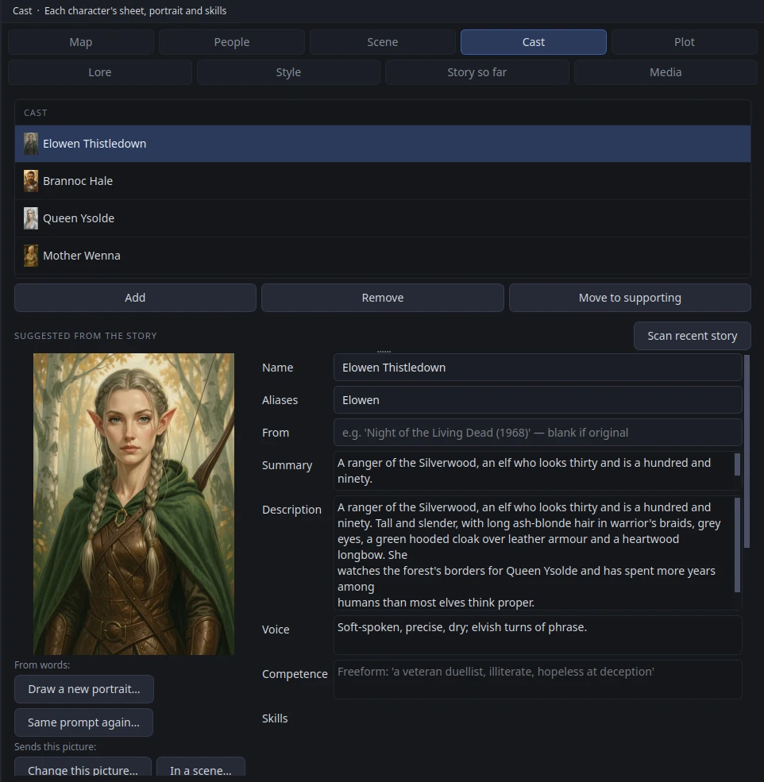

In a story played on its map, **On the map** under the portrait shows the
character's avatar, the little pixel-art figure that walks for them, and
says where it came from. Click it to see it whole, pixel for pixel. **Draw
the avatar…** (**Draw the avatar again…** once there is one) has the map's
sprite model draw it from the portrait, or from what the card says of them
when they have none; the model and price are shown first, and it counts
against the day's map pictures. **Draw with instructions…** asks what the
avatar should look like, in your own words, and draws it from them instead
of the portrait. Every avatar drawn or chosen is kept: **Choose a drawn
avatar ▾** lists them, the one walking for them ticked, and the Media tab
lists them under Map as "Avatar", the one in use marked, with **Use as the
avatar** on the others. **Choose a file…** takes a figure of your
own (on a plain white or transparent ground), and **Back to the set's own**
puts the tile set's figure back. Every character gets an avatar drawn from
the portrait they have now: with map pictures on, avatars are drawn once the
story has begun (Start offers the portraits first), a character whose
portrait is being drawn waits for it, and one drawn from their card before a
portrait came, or from an earlier portrait, is drawn again when a new
portrait lands, as the rest of the map's pictures are (on its own, or among
those waiting for you). A character the plot keeps hidden gets none drawn
until the story brings them in. An avatar you chose yourself stays until you
say otherwise: when new portraits land on such cards (or map pictures are
off), you are asked once whether to draw their avatars again from them, and
they are drawn one after another, even if one is already being drawn. The
same changes can be made under Look → **Edit the tile set…** on the map.

Two checkboxes on a cast sheet decide who writes that character:

- **Available to play** on (the default) — you can play them, and the model
  voices them on the turns you don't.
- **Available to play** off — they are the model's: it writes their speech,
  thoughts and choices in full, and they leave the *Speaking as* list. Use this
  when you hand a character over, including one you have been writing yourself:
  the roster tells the model that it now voices them.
- **Never voiced by the storyteller** — yours on every turn, not only while you
  play them. The model is told never to write them.

## The People page

A story without a map opens on **People**, beside the story: who is in it,
by their faces. **Here now** has whoever the story has in the scene, large,
the character you play first (marked **You**); **Not here** and **Also in the
story** have the rest of the cast and the supporting characters, smaller,
with where they are when the story has said. Each card is a portrait, a name
and the first line of their summary. Click a card for the whole profile, on
the Cast page; right-click it to draw a portrait, choose a picture of your
own, or play as that character. A card with no portrait has **Draw a
portrait…** and **Choose a picture…** on it.

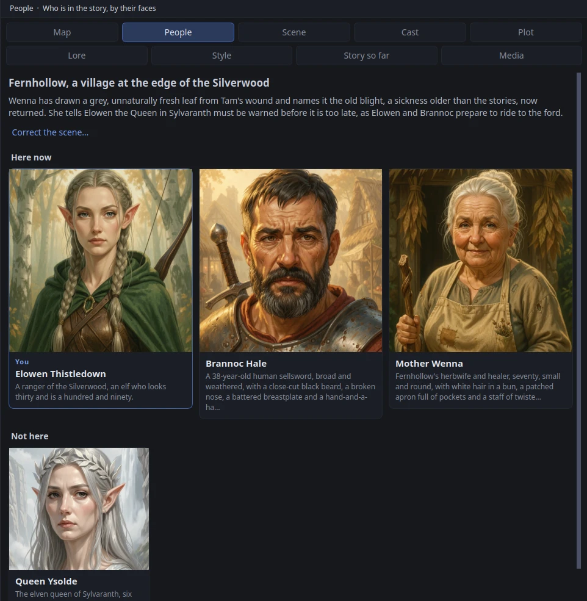

Until the story has them, a panel at the top offers **Draw portraits…** for
everyone who has none (you see and can change every prompt first, as in
Story → Draw pictures for the cards…) and a background behind the story
(**Draw a background…**, or **Choose a background…** from your computer).
Pictures need an image model: without one, **Set up pictures…** opens
Settings → Images. **Not now** puts the panel away until you next open the
story. Characters the plot hasn't brought in yet stay off the page, as they
do on the Cast page.

Who is here is the scene's (below), so the faces show at a glance who the
storyteller thinks is in the room; **Correct the scene…** goes to the Scene
page to put it right.

In a story played on its map, who is here is the map's: whoever it has in
sight or within earshot of you, as the storyteller is told. Someone there the
story hasn't named yet ("the woman at the rail", Unknown 1 on the map) is
listed under **Also here, with no card yet** with **Name…**: say who they
are, one of the cards or a name, as the map's own correction does.

Someone the story has here who has no card (named in the opening or by a
passage, never given one) is listed under **Also here, with no card yet**,
with **Make a card**: as a supporting character, or in the cast so you can
play them. The card is written from what the story says of them (a short
call to the summarisation model; with nothing to go on it has their name
alone, for you to fill in) and opens on the Cast page, where you can draw
their portrait. On a map, they then get an avatar of their own instead of
one of the tile set's figures. Right-clicking them on the map offers the
same.

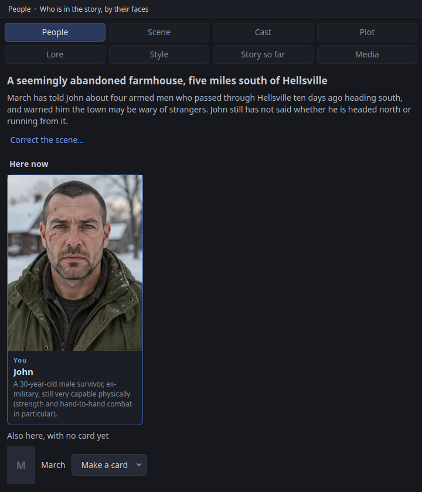

## The scene, and who can walk into it

The **Scene** tab holds where the story is — location, time, what's going on —
and who is in it. Presence is an arrival rule, not a fence: someone not in the
scene **can** come into it, and the model is told to show them arriving, with a
reason and a way in. What it may not do is have them already be there, overhear
or answer the scene from outside it (no listening in on the comms), or act on
something they had no way of learning.

Afterwards, what happened is part of the world. Public things spread on their
own — a fight in a bar, a ship coming in, a death on the promenade reaches
people who would care, as fast as that world carries news. Private things stay
private until someone tells, someone who was there passes it on, or the
aftermath makes it plain.

**The scene keeps itself.** After each passage a small, cheap model reads what
it changed: who came in and how, who left, whether the scene moved, and
whether it is private. The Scene tab follows, and says what changed — "Changed
by the story at passage 213: +Hollis (came in from the constable's office),
−Ruiz (left for the clinic)" — with an **Undo**. Anything you change yourself
wins, and the next read starts from your version. The roster covers everyone
with a name, not just your cast: your cast first (the one you are playing is
marked "you"), then the supporting characters, each ticked when they are
here, then **Also here** for the story's own people who have no card. The
read gets things wrong at times, which is why the People page beside the
story shows who is here by their faces: a glance after each passage shows
who the storyteller thinks is in the room, and a tick on the Scene page fixes
it.

The same read catches the shortcuts. If a passage has someone simply already
there, listening in from outside, or acting on something they couldn't know,
the status bar names it once, quoting the sentence, and the sentence stays
with the passage as evidence for a settings review.

Choose the model for this in **Settings → Models → Scene model**; it is one
extra call per passage, on your story model if nothing smaller is set. It is one short call
per passage, so a small fast model is right; blank uses the summarisation
model. Untick **Keep the scene up to date after every passage** to keep the
roster by hand instead, as before.

The scene is saved with each passage, so switching to another take or branch,
taking a turn back, or deleting messages puts the roster back to what it was
at that point. If the character you are playing isn't in the scene there
(on another branch the story left them elsewhere), a banner above the story
says so, and nothing changes on its own: **Put … back in the scene** moves
the scene to them, as choosing them under *Playing* does (choosing the one
already shown counts too), and **Leave it** keeps the scene as it stands.
The one you are playing can't be unticked on the Scene page: the scene is
wherever they are. Choose someone else under *Playing* first.

The scene's **Time** is your starting time: it goes into the opening, and from
then on the story's own prose says what time it is. In a story with a plot the
plot's clock keeps the time instead, and each chapter summary is headed with
the story days it covers ("Chapter 4 · days 12–15"; Settings → Context can
turn that off). The field is shown only where it is used.

**Who knows what.** Each scene records who can know what happens in it:
everyone, in time, or only those present. When a scene ends,
where it was, who was there, and what it amounted to go into **Recent scenes**,
which the model sees, so a private conversation stays with the people who were
in the room. Taking up a character who is somewhere else moves the scene to
them rather than pulling them into the current one.

**Update from the story** still reads the recent passages afresh and proposes
all the fields for you to approve, for when the card has drifted.

**Story → Setup… → About → World** sets how much happens that you didn't start:

| | |
|---|---|
| Quiet | the world answers you but rarely intrudes |
| Normal (default) | people pursue their own aims, anyone with a stake acts on it, earlier choices catch up |
| Eventful | most passages bring something: an arrival, news, a complication |

## The map

A story can keep a map that grows as it goes: tick **Keep a map of the story**
on Story → Setup → About (a simple chat can too: **Keep a map of the
conversation**, see "Simple chat"). After each passage a small model (Settings → Models
→ **Map model**) notes the places the story went to or described, how they
connect, who is where and the things that matter, each held to a sentence of
the story. A place is put on the map once, where the story said it is ("five
miles north", "around back", inside the town), and stays there: once the
story has been somewhere, that is where it is. Walk off the edge of the map
and the storyteller decides what you find there; the map grows to take it in,
and it is part of the map from then on.

A plot file can bring a map drawn up beforehand (`# Map`, in the format
guide): its places stand where the file puts them from the first passage, the
places you haven't found yet are under fog, and a place the plot keeps hidden
stays off the map until the plot reveals it. **Doomsville with a map**, among
the samples, starts this way, and comes with its map's art already drawn, so
it opens complete; a restart keeps it. A story you make draws its own as it
goes.

The map is drawn in the background (Settings → Models → **Map art model**;
untick **Draw the map** to keep it plain): the land around each place the
story reaches, the ground plan of each place you have been, and a small
picture of each place and thing. Each is drawn once and kept. When the story
changes something (a barn blown up, a truck burnt out), it is drawn again as
it now is, as an edit of how it looked, so it is still the same barn, and
the local map shows it as it is now. A station or ship is drawn as its decks.
While it draws, the map says how far it has got, what it is drawing and with
which model ("Drawing the map: 3 of 12 · the gun cabinet, by FLUX.3 Image
Klein"), and says when it is done. A room's furniture is chosen first and
its pieces drawn straight after; until a piece has its own picture it shows
as the tile set's nearest look-alike, so the room looks much the same when
the pictures land. A piece the model got wrong twice is given up on
and named there ("The map is drawn, but not The dark rift"), with **Try
again** beside it. A branch shows the map as it stands on that branch.

A place the story adds inside the area you are in (a rift opened at a
marked spot, a well, a shrine) is marked on the play view where it stands,
with its name over it and its small picture once that is drawn; a building
is drawn into the ground itself, roofed as its description says it is built
(stone, slate, thatch, metal…). Someone the story brings in without a name
stands on the map as **Unknown 1** (then 2, 3…) until a passage names them;
the menus and the storyteller call them as the story described them ("the
teenage girl"). When a plot event brings a character in and the passage
introduces one person without a name, that person is the character, as long
as the description is of one person and not of the other sex ("the
watchmen" stay unknown). A thing the tile set has no picture of borrows the set's
nearest one of the same kind until its own is drawn. When the set's own
suits it as it is (a "workbench" and the set's heavy wooden workbench, a
"cast iron stove" and its cast-iron wood stove), that one stands for it for
good and nothing new is drawn; a different kind of the thing (a rifle rack
is no tool rack), another material, a broken one or one holding something
else gets its own.

**Draw map pictures** (under Settings → Images) has an image model (the
**Map picture model** there, FLUX.3 Klein unless you choose another) draw the
map's people, buildings and things instead (it needs **Draw the map** on). A
character's avatar is drawn from their portrait by the model's editing
version; a model that takes no picture draws it from what their card says: everyone's avatar from their portrait
or what their card says of them (you first, then whoever is with you), roofs
of what each building is made of, the things in each room, and each building
standing on the ground where the story put it. **Automatically** (the
default) draws them in the background as the story reaches them, without
asking, up to **Without asking, at most** (10 at once unless you change it;
"any number" never asks). More than that at once, such as a story you
played before a newer version opening with everything since to catch up
on, wait as they would under Ask before drawing, and the Map page says why.
**Ask before drawing** draws nothing until you say: the Map page says
how many pictures wait and what they cost, with **Review…** (every picture
with its prompt and price: change any prompt, untick what you don't want, and
**Draw** sends the ticked ones exactly as they stand), **Draw them** (all, as
they are) and **Not now** (none; you aren't asked about those again while the
story is open). **Off** draws none. Either way they stop at the limit set
there for each story each day, and each one's prompt and cost are kept in
the story's log. A place
the story changes is drawn again from its last picture, so it stays the same
place. Each place you have been gets a postcard too, a picture of the whole
place, shown on its card under the local map: click it to see it whole.
Everything drawn for the map stays with the story: a restart, Duplicate
settings and a scenario file keep the art and the pictures. Story pictures
(Picture…) still show you every request first.

Each area on the map (a farm, a town, a works) can have **paintings**: the
place as it stands, painted by an image model (Settings → Images →
**Painting model**: FLUX.3 Klein unless you choose another, about a cent a
painting; **Recommended** beside it offers two enhanced choices, Seedream 5.0
Pro at about $0.09 and Nano Banana Pro at about $0.14). On the play view, **Paintings ▾**
is for the place you stand in: **Paint this place…** shows the model and its
price first (it counts with the day's map pictures) and paints the area as
the play view shows it at that moment, everyone and everything where they
stand, in the hour's light and the weather (pressed while the map is still
drawing the place's pieces, it waits for them and starts by itself); under it the menu lists the
place's paintings, newest first, each opening on its own to zoom into. The
model is given the program's own picture of the area (the tiles, with the
people and things on them) and asked to keep every building, wall, road and
stretch of water where it is while painting a finished, atmospheric scene,
and is told the time of day, the weather, who is there (by their looks,
never their names, so nothing is written on it) and the things at hand. On
the 2D map, an area that has a painting is marked **◆ Painting** wherever
its painting isn't drawn: at its corner on the local map, and under its name
on the region, so you can see which areas have one without going into them;
click the mark to see that area's. **Paintings** lays every area's latest
painting over the map, exactly where the area is, so you see what it shows
and where that is among everything around it; **Fade** lets the map show
through, and **See it whole** (or a double-click on a painting) opens it on
its own to zoom into. The bar over the map is for the area in the middle of
the view, wherever you have moved the map: **Paint it** paints that area
from its map, giving the model and its price first, and **Paint it again**
paints another take. The samples come with a painting of every area. The 2D
map is the story's truth: a painting matches it closely, not exactly. Once
the story changes something there (the barn burns), the painting says it is
out of date and offers to paint it again. **Use a picture of your own…**
takes a picture from disk as the area's painting instead, cropped first to
the area's shape. Every painting made or brought in is kept: the newest lies
over the map, and once an area has several the bar says so and **Choose a
painting…** lets you swap between them (the choice is for the map as it is
there now; a painting made after a change is chosen for that change). The
paintings and the postcards are in Media too, under **Map**, the one on the
map marked; right-click another there for **Show this painting on the
map**. While you play on an area, its own painting isn't shown over it; zoom
the Region in on another area to see that one's.

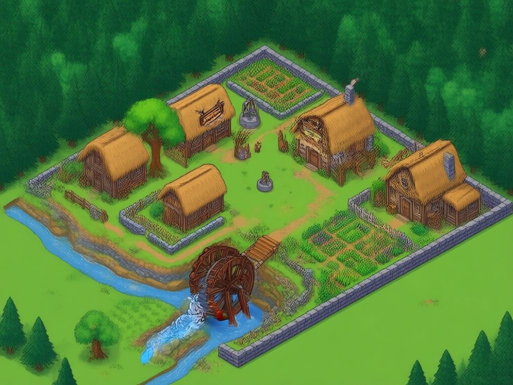

A story that keeps a map makes it part of the window: the panel beside the
story takes half the window with **Map** as its first page. **Map**,
above the transcript, goes to it.

A station or a ship in space is laid out by SealedLore itself: the map art
model only says what it holds (its shape, its decks, and each deck's rooms),
and every deck is laid out round one lift lobby, the lifts in the same place
on every deck, with corridors, airlocks and viewports. A station is rooms all
through, any gap between them filled with storerooms and machinery rooms,
unless it is a ring: then its rooms and corridors stand round one open middle.
Its hull is drawn round it: a station's rounded body, a ship's hull narrowing
to its bridge at the bow with its engines at the stern, an outpost dug into an
asteroid set in rock. Each room is drawn for what it is, and the
rooms that make a station what it is have their set pieces: a reactor in
engineering, consoles and a command chair facing a bridge's viewport, a
shuttle in a hangar, a mine's shaft, a garden's beds.

A plan is drawn once and kept, so one that came out
wrong stays so; **Redraw plan…** on the local map draws the plan of the area
in the middle of the view again (you are asked first; the buildings you have
been inside keep their own plans).

During a private scene the map stays in the window but is paused: it shows
the story as it was when the scene began, nothing from the scene is read into
it, and nothing is drawn or painted. Once you approve the scene's summary, the
summary is read like any passage and the map catches up.

### Playing on the map

A story that keeps a map is played on it. **Local** is the place you are in,
drawn tile by tile in a tile set: the farm and its buildings, the inside of
the farmhouse with its rooms and furniture, everyone where the story put
them, you ringed in gold. The map is exact, and the storyteller is told it
exactly: where you stand, who is how far from you and which way, what is
within reach, the doorways out. Someone a passage leaves at a building's
door, on its porch or in its yard stands outside it, at its door, until the
story or a walk takes them in.

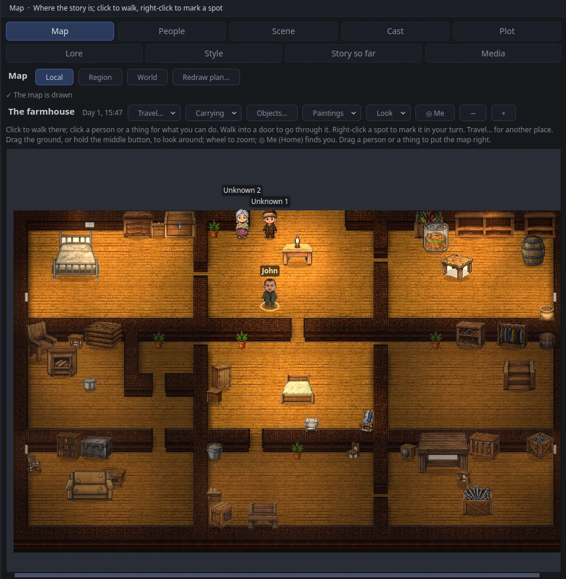

- **Walking.** Click anywhere to walk there (the arrow keys or WASD take a
  step); the tile under the pointer shows gold where you can stand and red
  where you can't, and a click while you are still walking goes on from
  where you are. Walking costs no model call and moves the clock a little;
  walk into a door to go through it, into a building or back out. A boat or
  a cart the story docks somewhere lies there at its own size (a boat on
  the water by the shore), its name on the ground beside it; one with an
  inside of its own is boarded there, and left there. Drag the
  ground, or hold the middle mouse button and move, to look around (the
  middle button pans the Region and World maps too); the wheel zooms; **−** and **+** zoom, up to twice the art's
  own pixels. The hour tints the area (blue at night, amber at dawn and
  dusk), and indoors the rooms you can see into are lit and the rest dimmed.
  The storyteller is told the time of day in words ("It is dusk"), never
  the day. Weather the story states, or that you state in a Direction ("It
  begins to snow"), is kept with the map, told to the storyteller beside
  the time of day, and shown over an outdoor area: snow, rain, fog or mist,
  sand or dust. Clear weather shows nothing.
- **People.** Click someone for **Talk** (you walk up to them, and they
  react as themselves: someone who knows you notices you and says hello,
  someone hostile may not), **Look** (you stay out of sight and watch what
  they are doing) or **Attack**.

  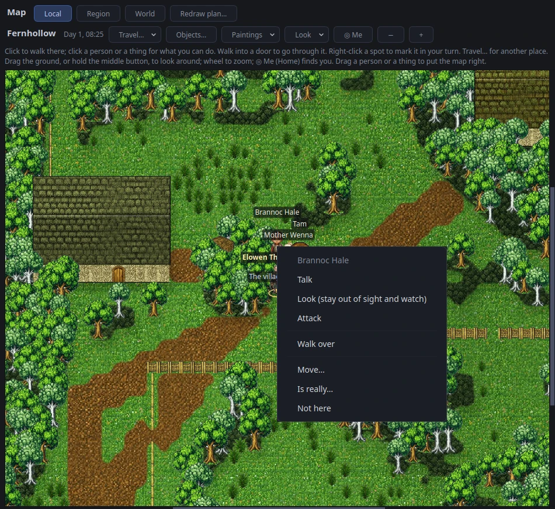
- **Things.** Click a thing for what can be done with it: **Use**, and
  **Take**, **Eat** or **Destroy** where they fit. You walk up to it first.
  What the choice does is recorded by the program when the turn is sent,
  not left to the storyteller: **Take** puts the thing with your character
  (off the floor, and the storyteller is told who carries what), **Destroy**
  leaves it standing visibly broken (darker, cracked, rubble at its foot;
  it can't be destroyed again), **Eat** consumes it. A thing the map's own
  list knows follows suit (carried by you, broken, gone). A turn you rewrite
  so the menu's words are gone changes nothing, and neither does a failed
  dice roll: the attempt is the storyteller's to tell. **Use** changes
  nothing either.
- **Every thing on the play view is a thing**, whoever put it there: the
  plan's objects, the furniture the map laid in the rooms, and what the
  story brought in (an anvil a Direction left by the door, a rifle on the
  table). What the story adds lies at its place on the play view, beside
  you when it turns up where you are, on the very spot when your turn marks
  one. What a passage does to any of them follows on the map: shoved across
  the doorway, it blocks the doorway; carried off, it is with whoever took
  it; smashed, it is drawn broken; eaten or used up, it is gone.
- Things come in four kinds, by what they are. Small things can be
  **taken** and carried. **Heavy** things (a table, a chest, an anvil, a
  boulder) can't be carried off, but they can be shoved, dragged or rolled
  by someone strong enough: the storyteller decides whether an attempt
  succeeds, and the map follows what it writes. Things that are **part of
  the building or the ground** (a hearth, a stove, a well, a counter, a
  tree, anything bolted down) stay where they are whatever a passage says,
  unless your Direction or Narration moves them, or a turn sent under
  **Fiat**; the map read may still change their state. On every other turn
  the storyteller is told so: such things near you are marked "fixed in
  place", and one your turn names is named again at the very end of what it
  is sent, with word that an attempt to move it fails. To move one, send
  the turn under **Fiat**. Something driven or ridden (a truck, a cart, a
  horse) goes with whoever takes it.
- **Carrying ▾** lists what your character carries, each with **Drop** (it
  lies at your feet again, to be picked up by anyone) and **Give to** each
  person within reach (it is theirs then, and their card says so). The
  Cast page shows "Carrying: …" under a character's avatar.
- A choice puts its turn in the composer ("I walk over to Jane."), for you
  to send as it is or add to; the storyteller is told what the choice means
  as long as the menu's words are still in the turn.
- **Travel…** sets off for another place on the map, with how long it takes
  on foot; the turn goes in the composer, and when you send it the clock
  moves on by that much and you stand there. A turn you rewrite before
  sending travels nowhere. The next passage begins on arrival. A place
  whose plan isn't drawn yet lands you on the open country at its door.
- **Floors and decks.** A place whose words call for more than one level
  (a two-storey house, a cellar, a station's decks, a dungeon's levels, a
  keep) is drawn level by level: its plan is the ground floor or main deck,
  and each other level comes as a plan of its own, after it, with its
  stairs in the same tiles. Stairs (a ladder or a lift counts) are the doors
  between levels: walk onto them to go up or down, as you walk into a door,
  and you land a step off the stairs on the other level. The title above
  the area says where you are ("The farmhouse · Upper floor"); the
  storyteller is told the level you stand on, the stairs from there, and
  who is on another level of the place. Each level is furnished on its own.
  The Region and World maps show the plan's own level.
- **Edges.** Walk off the edge of an outdoor area (the arrow keys past the
  last tile, or **Leave north ▾** when you stand on it) to walk on into the
  area beyond, where one adjoins and nothing bars the way (water, trees or
  rock at the far edge do), or to set off for the places that lie that way.
  Where no place adjoins, **Walk on into open country** does. A farm's, a
  village's or a site's plan has a way out to each of its edges, and the
  ground just past it on the land is cleared and joined to the open
  country, so a village in a forest can be left on every side; water, the
  dark of a chasm or a wall still bar the way.
- **Open country.** Between places, in a region, a desert or a forest, or
  in no place the map names, you stand on the land itself, laid out as a
  grid of regions about the size of a farm (400 m across, walked at 2.5 m a
  tile, as the farm is) starting where the story begins. **The world
  designer** designs them ahead of you, the one you stand in and the eight
  around it, and the next ring as you walk on: each region's land, a few
  places (buildings you can enter, landmarks, a settlement), things to find
  and people or creatures, to fit the world, what has happened in the
  story, and the regions beside it, whose roads, rivers and woods carry on
  across the edges. How much a region holds is **Settings → Models → Open
  country**: Sparse (at most two places, one thing and one person or
  creature), Normal, the default (three places, three things, one person),
  or Rich (five places, eight things, three people). A region designed
  already keeps what it has. In a world of want, tick **Things are scarce
  in this world** (Story → Setup → About → Scarcity; a plot file's
  `scarce: yes`): the designer keeps food, fuel, weapons and whatever else
  the world holds scarce rare, hidden or hard to reach rather than lying
  about for the taking. Leave it off for a world without scarcity. On a map
  that came with a plot file (the samples' among them) the file's world is drawn already: the designer
  waits while you are on one of its places (a farm, a town, a site, a
  building; a region or a forest too wide for a plan of its own doesn't
  count), and begins the first time you stand beyond them all. It runs on the story model unless Settings → Models →
  World designer model names another, a ring of nine taking about half a
  minute, and only while **Draw the map** is on. A region is kept once
  designed, on every branch, and stays under fog on the Region and World
  maps until you have been there; the next one is painted as you near its
  edge, so it shows the moment you cross. Nothing the designer put in a
  region has its own picture drawn (under Draw map pictures) until you have
  been in that region: until then the tile set's nearest thing stands in.
  Nobody is designed close by you, nothing the story already has is
  designed again, and nothing is put on a place's own ground (a farm, a
  town, a site with its plan), where its plan would hide it. The map read is
  shown only the region you stand in, and never moves anyone into another
  region unless the passage names the place. Places the story has stand
  where they are, a settlement or a building entered by its door, and the
  storyteller is told what is near you with its distance, and every region
  designed so far. The world has no edge: the map grows as far as you walk,
  at the cost of the designs and drawings. A city too wide to walk tile by
  tile (up to 8 km) gets a plan at a coarser grain.
- **Changing the map by Direction.** A Direction or Narration states what
  is so, on the map too. Besides adding a place (at a marked spot, or by
  its distance and bearing from one) and changing what state a place is in
  ("The barn is a furnace now"), it can take a place off the map ("The barn
  is gone": whatever was in it stands in the place around it), rename one
  ("The inn is now called The Drowned Rat"; the old name still finds it),
  resize one ("The castle is a vast fortress, three hundred metres across";
  its plan is drawn again at the new size), move one (to a marked spot, or
  "the mill now stands two kilometres north of the village"; what is inside
  goes with it) or put one inside another. The map read quotes your words
  for each change, a passage can't make them, and a place your turn doesn't
  name stays as it is. The notice under the turn says what the map did.
- **Marking a spot.** Right-click anywhere, on Local or on the Region and
  World maps, and choose **Mark this spot in your turn**: its
  coordinate goes into the composer at the cursor, as `⌖(412, -88)` (metres
  east and north on the map; the readout beside the buttons shows the
  coordinate under the pointer). Write what happens there: "A dark rift
  opens at ⌖(412, -88)", "Elowen goes to ⌖(412, -88)". The storyteller is
  told what is at each spot and how far it is from you, and whatever the
  turn puts there, a new place or someone sent there, is put exactly there
  on the map. A pin shows each spot the turn marks.
- **Go here.** Right-click a spot on the map for **Go here**: a spot in the
  area you are in is walked to, one elsewhere is travelled to, as Travel…
  does (when the turn is sent).
- **◎ Me** (or Home) centres the view on you, on Local and on the map.
- **Correcting the map.** When a passage's reading of the map gets
  something wrong, put it right by hand: no model is asked, and no time
  passes. On Local, drag a person or a thing to the tile where they really
  are (or right-click it, **Move…**, then click where; Esc cancels). The
  right-click menus have a **Correct the map** section: for a person,
  **Name…** (someone not named yet: one of the cards, or a name) or **Is
  really…** (named wrongly: another card, a name, or someone not named yet
  after all), and **Not here** (taken off the map and off the scene card);
  for a thing, **Rename…**, **Broken** or **Whole again**, and **Remove**;
  on an empty tile, **Put someone here…** and **Put a thing here…**. On the
  Region and World maps, a place's right-click menu has **Rename this
  place…** (its old name stays as another name for it), **Move this
  place…** (then click where it stands; what is inside it goes too), **Put
  it inside…**, **Merge into…** (a duplicate: its people, things and places
  go to the other) and **Remove from the map**; and on any spot, **Add a
  place here…** (its name, what kind of place, how wide, and what it is like):
  it is on the map from then on, told to the storyteller, and drawn when the
  story goes there. Someone moved into or out
  of your character's company is put on or taken off the scene card's
  roster too. A correction belongs to the latest message, so each branch
  keeps its own and the next passage is read from the corrected map; the
  last one can be undone (**Undo** in the same menus) until the story
  moves on.
- **Objects…** (above Local) makes things and puts them where you want
  them, mainly to set a place up before you play, though it works at any
  time. Type what you want, separated by commas ("an armchair, a small side
  table, a worn rug"), and press **Make**: the panel says how many pictures
  that draws and what each costs, and each is drawn in the tile set's style
  (one the tile set already has isn't drawn again). Until its picture is in,
  an object shows as the tile set's nearest thing. Then choose an object,
  yours or any of the tile set's, and click on Local to put it there; it
  stays chosen, so you can put down several (Esc stops). **Remove things**
  takes anything you click off the map, the furniture that came with the
  place too. Placing and removing are corrections like those above: no time
  passes, the storyteller is told the room as it now is, and Undo puts the
  last one back. Objects… is in Edit Mode's bar too (see "Edit Mode" below).

  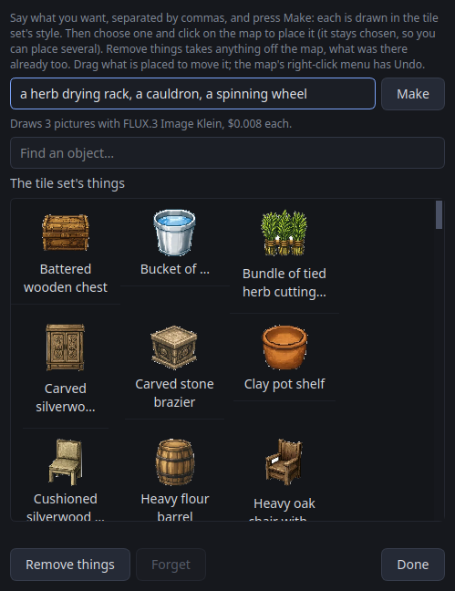
- **The clock** (Day 1, 08:00, beside the place's name) moves with walking
  and travel, with the time the passages tell, and with a Direction or
  Narration that says time goes by ("Three weeks pass"). In a story with a
  plot it is the plot's clock, so travel passes the plot's days. The
  storyteller is never told the day; it is told how far you walked since the
  last passage, and the reads that keep time are told that walk is counted
  already.
- **Who can see whom.** Walls and rock stop sight; windows, fences and
  doorways don't, and a few trees deep do. What you can't see from where you
  stand is the fog of war: indoors it is shaded, and anyone out of your sight
  isn't shown at all until you can see them. Someone outside at a door of
  the building you are in (knocking, say) shows at that door, beyond its
  wall, whenever you can see the door. The storyteller is told where
  everyone is, and who is in sight of you and within earshot.
- Nobody else moves on their own: people stand where the story last put
  them until a passage moves them.
- Nothing can be walked while a passage is being written.

The map's rules hold everywhere: every room can be reached (a plan that left
one sealed gets a door), roads never run through buildings, doorways and
walkways stay clear of furniture. **Rooms** on Story → Setup → About sets
how full the rooms are (Sparse, Normal, Full); a building is furnished by the
map art model the first time the story is in or beside it.

**Look** chooses the tile set the map is drawn in: one of those that come
with SealedLore (a snowbound farm, an elven forest, a steampunk city, an
industrial wasteland, Hell, a space station), or one designed for your
story. A sample comes with its own. For a new world there are three ways,
offered as **Map tiles** in the Start dialog, before anything is drawn:
**The AI chooses the closest set** (the map read's model reads your world
and picks the nearest set, and says why), a set you choose yourself, or
**Design a new set for this world…**, which opens the designer before the
opening is written; the map's things then wait for the new set rather than
being drawn in another's style. The set is chosen once, when the story
begins, and kept for the whole story: it changes only when you choose
another. The first time a story's map opens, a line over it says which set
it is drawn in (and, when the AI chose it, why), with **Choose a set…** and
**Design a new set…** a button away; the same is under Look, where **The
AI's choice, closest to this world** asks again. The gallery shows every set
as a card, with a strip of its textures and sprites, its style in words and
what it suits, the one in use marked: **Use this set** switches, **Remove…**
takes a set drawn for this story out again (its pictures deleted; the ones
that come with SealedLore stay), **Let the AI choose** has the AI choose
again, and **Design a new set…** opens the designer. There you name the set
and describe the look you want, in your own words (prefilled with your
world and the style now in use: "gritty rain-slick cyberpunk alleys, neon
and wet concrete", "bright and cheerful storybook meadow"). Under
**Pictures of the world** you may add up to six photos or renders, each
with what it shows ("a photo of what a typical bar looks like in this
setting"): the designer looks at them and works the set's materials,
colours and buildings out from them, while the image model that draws the
tiles never sees them (it would copy them). **Designed by** is the model
that designs it, Claude Opus 5.5 unless you choose another (Recommended ▾
beside the field), and your choice is kept; a model that can't read
pictures is sent none, and the dialog says so. **Write the design** has it
write the set's words and a prompt tailored to every picture from your
description, your pictures and the world; you see and may change each of
them, with the number of pictures, the image model that draws them and the
price of the whole set at the model's listed prices, and nothing is drawn
until you press **Draw the set…** and confirm. Each picture is then sent
exactly as its prompt stands, in the background, and the map is drawn in the
new set once all of it is in; the set it had stays until then. A story may
keep several sets of its own and swap between them under Look, and they
travel with Restart, Duplicate settings and scenario files.

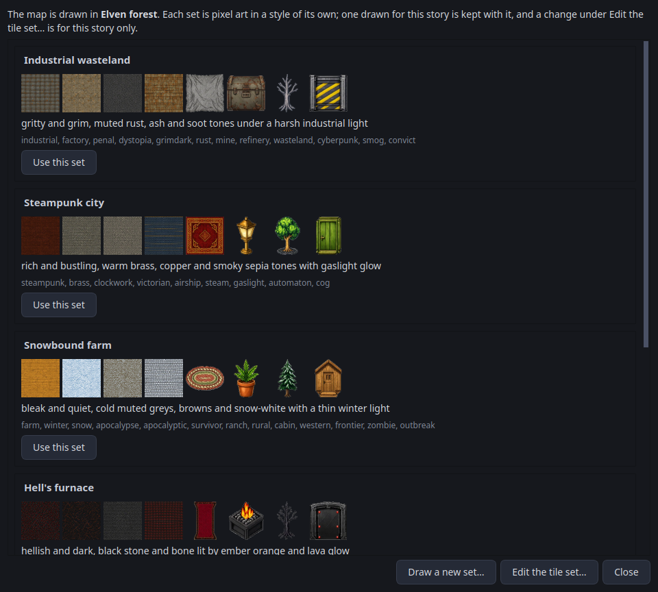

Things and people the set doesn't have are drawn as the story needs them,
with **Draw map pictures** on (Settings → Images; FLUX.3 Klein, about a
cent each): each kind of thing once, each character from their portrait,
and, in the set's own style, any ground it has none of (sand where the set
is a snowbound farm, a station's metal deck) and any roof material. Until
then a thing is a plain crate, a character a small figure, and new ground
the set's own coloured to match. The samples come with all of theirs. **Edit the
tile set…** (under Look, and in the gallery) lists every picture the map is
drawn with: the ground, walls and decoration, every thing and every
character's sprite, with the words each was drawn from. Change the words
and **Draw it again…** (the model and price are shown first), **Use a
picture of your own…**, or go **Back to the set's own**; a change is for
this story only. Everything drawn for a map is pixel art in a style that
suits the world rather than any one game's look: each shipped set names its
own (bleak and quiet for the snowbound farm and the abandoned town, whimsical
storybook for the elven forest, warm and earthy for the market town), and a
set drawn for your story takes the style from your
description (gritty and dark, bright and cheerful, whimsical…), which you
can see and change with the set's other words before it is drawn.

It is one map, read at three levels by zooming; **Local**, **Region** and
**World** jump to each. **Local** is the area you are in (the farm, not just
its farmhouse; a town; the caves), played on as above; before its plan is
drawn it shows the region. A story opens on **Local**. **Region**
is the country around you that the story has reached: each place with its
picture, small when far, its name bright where you have been or can see now,
dim where the story only told of it, ringed where you are now; it is where you
look to decide where to go next. Where several places lie too close together
at the zoom to name apart, their names stand in a column under them, in order
down the map, the place you are at first. The fog has three shades, named under the
map's buttons: the area you are in now is clear and edged in gold (what Local
shows), country you know but aren't in lies under a grey haze, and anywhere
unexplored is dark. **World** is the whole map zoomed out, its settlements and regions
named large and the small places hidden. Scroll to zoom (places inside others
appear as you zoom in), drag to move; double-click a place to go to it. Esc
goes out from Local to the region.

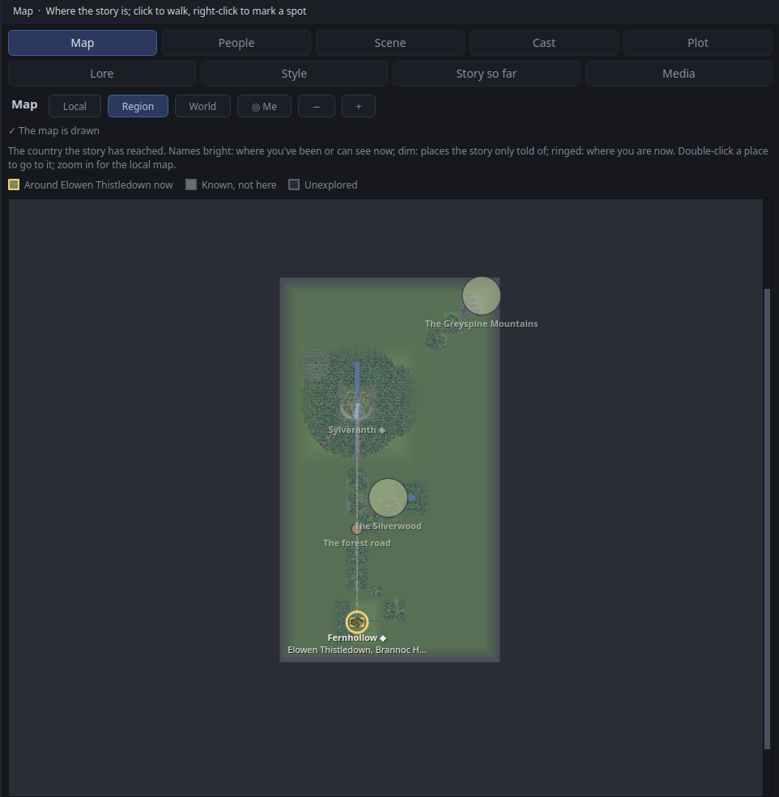

The map is the storyteller's too: each turn it is told where you are on it,
what is around and inside that place, the ways between them and the things
there, so a place you go back to is as the story left it. A map from a plot
file is told in the file's own words, with how far and which way each of its
places lies. That costs some words on every turn; untick **Keep a map of the
story** to save them.

**Story → Continue without the map…** goes on from where a map story is,
without the map, as a story of its own: a copy with every character, the
plot, the world and lore, every branch and the story so far, and, on the
branch you are on, the scene as the map had it (where you are, who is with
you, who is elsewhere and where, what each of you carries). Nothing is read, drawn or painted for a map
in the copy, and the storyteller is no longer sent it, so each turn costs
less. The map story stays as it was, to go back to. Like **Duplicate entire
story**, the copy's cost history includes the original's. Not for a chat kept
in memory only.

### Edit Mode

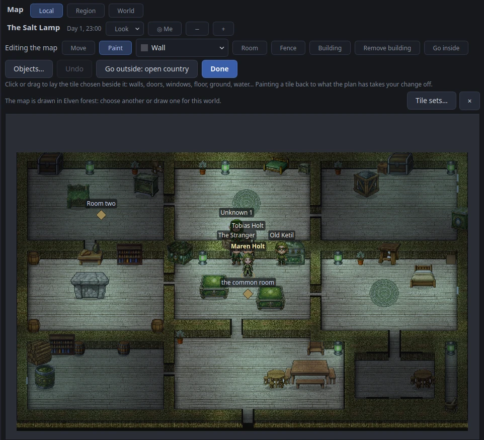

**✎ Edit map**, on Local, changes the map by hand, so you don't have to ask
for a change in a Direction and hope it is read the way you meant. Nothing is
asked of a model, and no time passes in the story. While the map is being
edited nobody walks; **Done** goes back to playing, and so does sending a
turn.

A story whose map it grows (drafted from an idea, written from scratch, a
simple chat) **opens in Edit Mode** once its first place is drawn, after the
opening and before your first turn, so you can make it as you want it before
you play. The samples and other plot files bring maps made by hand, so they
don't; a line on Local offers it instead, until your first turn.

The bar says what the tool in hand does:

- **Move**: drag a person or a thing to where they belong; click one for its
  menu (its corrections: rename, remove, broken…). The ground pans the view.
- **Paint**: click, or drag across tiles, to lay the tile chosen beside it:
  floor, wall, door, window, ground, grass, path, bridge, sand, trees, rock,
  water, fence, rubble, or nothing. A door painted into a building's wall
  leads in; one painted over doesn't any more. A bridge is walked on over
  water (a road the map drew across a river is one already). Painting a tile back to what the plan
  had takes your change off. What stood on a tile you make a wall or water is
  gone.
- **Room**: drag from one corner to the other: walls round it with a door
  onto the open floor beside it. Outdoors it makes a walled yard.
- **Fence**: the same with a fence, and a gap for a gate.
- **Building** (outdoors): drag from corner to corner and name it (and, if
  you like, say what it is like). It goes on the map where you drew it, with
  walls and a door; the storyteller is told of it from then on, and its
  inside is drawn as any building's is, by the map art model. Its roof is
  made of what its words say.
- **Remove building** (outdoors): click a building to take it off. One the
  map knows comes off the map, and whoever and whatever was in it go to the
  place round it; one only the plan drew is painted over. Its ground is open
  again. You are asked first.
- **Go inside** (outdoors): click a building to edit its rooms, walls and
  doors without walking there. **Go outside** edits the ground round the
  building you are in, and **Back to…** returns to where your character is.
- **Objects…** makes things and places them (see Objects… above).
- **Undo** puts back the last change, then the one before, a building added
  or taken off included.

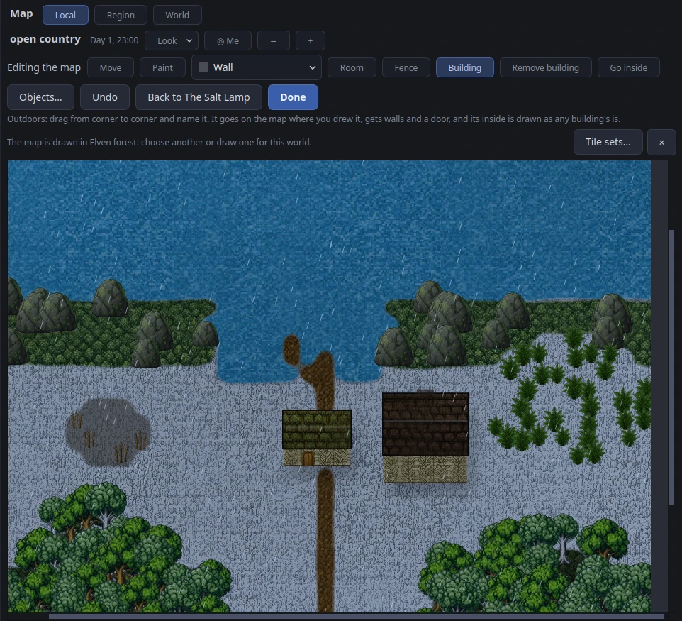

What you paint is kept with the map's art, beside the plan it changes: it is
the same on every branch, as the plan is. Buildings and places you add or
take off are corrections, so they belong to the message the story is at, and
each branch keeps its own. **Redraw plan…** draws a place's plan afresh,
and your painting on the old plan goes with it. The rules the map holds a
drawn plan to (every room can be reached, every building has a door) aren't
held against your own tiles: a room you wall up stays walled up.

## Branches, takes and export

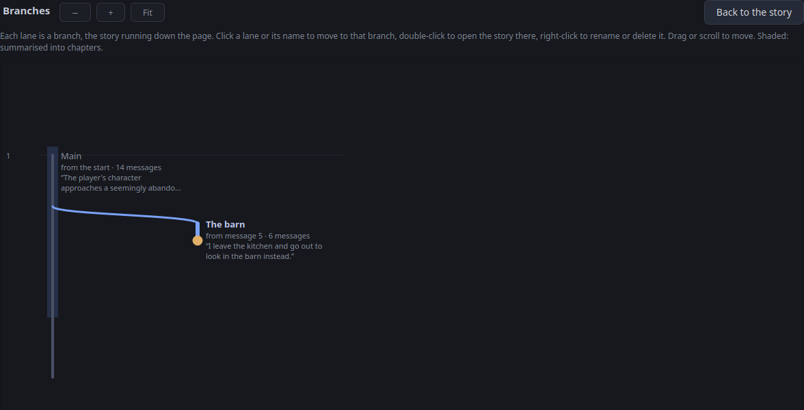

Every Regenerate keeps the old take: `‹ 2 / 3 ›` on a passage switches
between takes, in place. A take is another version of that one passage, so the
story after it stays where it is, whichever take is showing (if a chapter
summary covers it, the summary is marked out of date). The **⋯** menu on a
message offers **Regenerate this passage** (any passage, not just the latest).

A **branch** is a line of the story you split off on purpose. **Edit** on a
message corrects it in place (a typo, a name); **⋯ → New branch from here…**,
on any message, opens the same editor with a name field beside **Save as a
new branch**: saving starts a new branch from that message, rewritten or as
it is. A turn of yours is answered at once on the new branch; a passage is
your own prose and waits for your next turn. The story as it was is kept,
under its own name: the first line is **Main**, and a new branch is called
what you type, or "Branch 2", "Branch 3"… if you leave the name blank (a name
another branch already has gets a number). Rename any of them later. The **Branch** button above the
transcript always says which branch you are reading, and its menu lists them
all (where each starts and how long it is; hover one for how it begins),
switches between them, and
renames or deletes the one you are on (Main can't be deleted; pictures are
kept). The first message of a branch says "Branch … starts here". Regenerating
never makes a branch.

**Branches**, beside the Branch button, shows every branch of the story on one
diagram in place of the transcript, running top to bottom: a lane per branch
down the message numbers, each leaving the lane it split from where it split,
with its name, length and the opening words of the message it began with.
Summarised chapters are shaded, and a dot marks where you are. Hovering shows
a card with the branch, how it begins and ends, and the message under the
pointer; it stays while you read it. Click a lane or its name to move to that
branch (the map stays, with it highlighted); double-click to open the story
there; right-click to rename or delete it. Scroll or drag to move; **−**,
**+** and **Fit** (or the - and + keys, or Ctrl+wheel) zoom along the
timeline. Esc or **Back to the story** returns.

On your own turns the ⋯ menu also offers **Take back this turn**, which
returns the text and its settings to the composer and removes the turn and
everything after it — for when you want to reword what you wrote, or change a
setting, and send it again. In a story played on its map the walking and
travel the turn carried come back with it, so the turn sent again stands
where it stood. Double-clicking a chapter in **Story so far** jumps to it.

**Story → Export → Story backup…** writes everything (every branch, summaries,
questions, reviews, pictures and the API log) to one file; **File → Import…**
restores it. In the app one import takes every kind of file and does the
right thing with it: a scenario or plot file always becomes a new story ready
to start, and a backup comes back exactly as it was exported, messages and
all. **Story → Export → Markdown (this branch)…** and **Story → Export →
Current chapter as Markdown…** write the prose, without directions, OOC notes
or reasoning. In the terminal: `sealedlore export <id> <file> [--markdown]`,
`sealedlore import <backup>` and `sealedlore scenario import <scenario.json>`
(the terminal keeps the two apart, and has no plot-file import).

**Notices.** A notice in the status bar covers the controls on its left
(the model, its route, the budget) for a few seconds. Click it to dismiss it
at once.

**Costs.** Each passage shows its tokens, cache use and cost; the status bar
shows the session and whole-story spend, and **Story → Usage and cost…** breaks
it down. Where the endpoint doesn't report a call's cost (NanoGPT often
doesn't), it's estimated from the model's listed prices and marked `~`.

## Outcomes and dice

**Story → Setup… → About → Outcomes** sets how the result of your character's actions is
decided; **Outcome** in the bottom bar overrides it for one turn.

| Mode | What happens |
|---|---|
| Fiat | What you attempt succeeds exactly as written, with no added catch |
| Plausible | An implausible result may be scaled down, never to failure |
| Contested | The model judges, weighing your character's competence |
| Dice | The app rolls d100; the model narrates the result it's given |

In Dice mode, **Roll** picks which of your character's skills applies and how
hard the attempt is. Skills and tiers (none → legendary) are set in the Cast
tab, or drafted from the character's description with **Suggest skills**. The roll shows in the passage header (🎲 38 / 45 · success);
View → Show dice rolls hides it. Regenerate keeps the roll; **Reroll the dice**
in the passage's ⋯ menu rolls again. Only your character acting is rolled, never Direction or
Narration.

In the terminal: `/mode dice`, `/dice <skill|general> <difficulty>`, `/reroll`.

## Response length and style

The **Style** tab sets the story's default response length and the rest of
the style block (person, tense, prose density, pacing, content limits, phrases
to avoid), with a live preview you can hand-edit. **Person and tense are fixed
once the story has begun**: a switch would leave the story so far in the old
voice, so they are shown greyed for reference, and Story → Restart as new
playthrough… or Duplicate settings tells the story another way. One not set
when the story began can be set once. The rest can change at any time. Person
and tense are also restated on the last line the storyteller reads, which is
what makes it keep them. The **Length** control in
the bottom bar overrides it from here on: your choice stays until you change it
back, and the story's own setting is the first entry, marked *(story default)*.
**Outcome** works the same way. Regenerate uses whatever the two are set to
now, so you can ask for a longer passage and press **Regenerate** to get one.

| Preset | Target |
|---|---|
| Match my turn (default) | scales with what you write; a simple action gets under ~60 words, never more than ~250 |
| Brief | 1–3 sentences, ~20–60 words |
| Standard | about a paragraph, ~60–150 words |
| Descriptive | 2–4 paragraphs, ~150–300 words |
| Literary | several paragraphs, ~300–600 words |
| Custom | your own wording |

Each passage's header shows its word count, so you can see whether a preset
is doing what you want.

In the bottom bar, **Speaking as** chooses where your text lands: a character
(their words and actions), *Narration* (story prose in the fiction, not tied
to anyone), or *Direction* (instructions to the model, outside the fiction).
**OOC** attaches a direction to an otherwise in-character turn. Enter sends;
Shift+Enter starts a new line.

*Question* asks the model something out of character ("why did nobody
react?") and gets a plain answer rather than more story. It appears in the
transcript as a question and is never sent as part of the story. Ask about
something long past ("what did Marcus promise Elena?") and the chapters that a
merged part stands for are searched too, so detail the merge condensed away
can still be answered (see [Parts](#the-context-budget-and-archiving)).

Every message's ⋯ menu has **Delete from here…**, which removes it and
everything after it, after confirming. Deleting a reply leaves your turn in place, so Regenerate can take
another run at it.

## Lore retrieval

A small lorebook (up to a tenth of the context budget) is sent whole with
every turn, cached, and nothing is selected. Past that size, entries marked
**Always include** stay and the rest are chosen per turn. **Settings → Lore
→ Large lorebooks** picks how: **Model picks after each passage** (default)
has the lore model choose, plus whatever your own turn names; **Jev before
each turn** asks NanoGPT's decision model just before the turn;
**Similarity and keywords** uses embeddings and keywords alone.

Embeddings are off by default. Turn them on under Settings → Lore; leave the
base URL and key blank to reuse the chat endpoint's (the chat key is only
reused for the chat endpoint's own host, never sent to a different server).
The default model is `BAAI/bge-m3` (1024 dimensions, 8k context, no prefixes
needed).

Similarity scores are not comparable between models, so the threshold needs
tuning: the Lore tab shows the score on every hit and on the near-misses that
fell just under it. With embeddings off or the endpoint failing, retrieval
falls back to keyword matching and the status bar says so.

Keywords are matched against your own turn. When your turn names no entry,
the last exchange (your previous turn and the passage that answered it) is
searched too, then the last two, then the last three; the Lore tab says how
far back they reached. Your turn is the better guide: the story's own prose
names its everyday people and places on every turn, and matching it all
brought in far more than the scene needed.

### Lore that hasn't happened yet

The storyteller takes every entry it is sent as already true. An entry about
something still to come (an arrival planned for later, a secret that comes
out near the end, an event you have in mind) tends to happen early. Leave
such things out of the lorebook, write them as the plan they are ("Planned:
…"), or tick **Hold back until I mention it** on the entry. A held-back entry
reaches no model until one of your own turns or Directions names it, by its
title or one of its keywords; from then on it is ordinary lore. The Lore tab
marks it "held back" or "mentioned".

- It is decided per branch: on a branch that starts before your mention, the
  entry is held back again.
- The storyteller naming it doesn't count, and neither does a message in a
  private scene.
- Revealing a small lorebook's entry changes the part of the prompt that is
  cached, so that one turn costs a fresh cache write.
- A story made from a premise may hold back entries of its own, and the
  settings review can suggest holding one back when a passage brings it in
  too early.

## Pictures

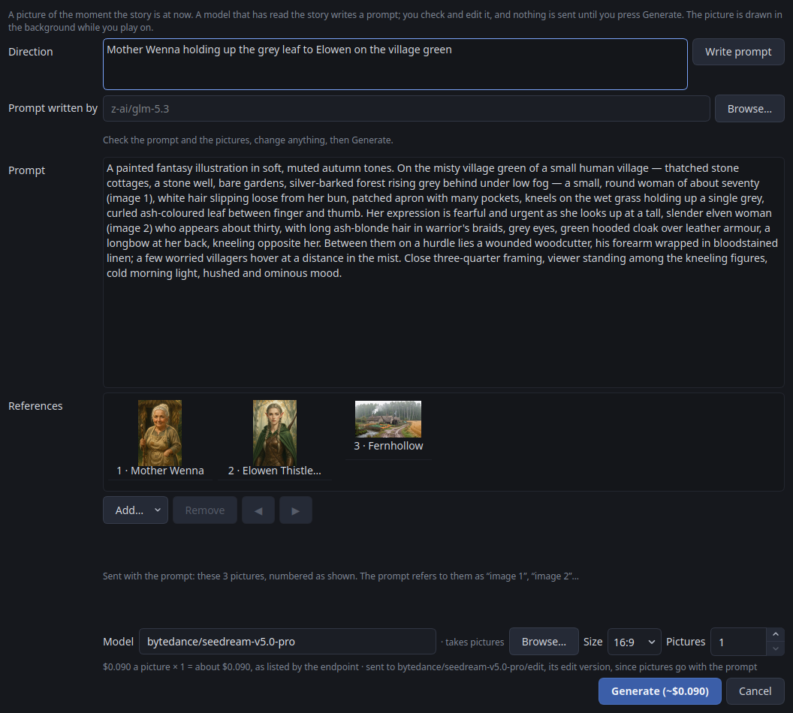

**Story → Draw a picture…** (Ctrl+Shift+I), the **Picture…** button beside the
composer, or **Illustrate this passage…** in a passage's ⋯ menu asks the
story's model to write an image prompt from where the story is, choosing
among the reference pictures on cast sheets and lore entries. **Add…** under
the pictures also takes any picture from disk (a place, an object, a pose that
belongs to no card); it is copied into the story, its hidden data removed,
and offered from then on. **Prompt written
by** in the dialog picks another model for that (blank is the story model;
your choice is kept, and is the same setting as Settings → Models → Image
prompt writer). The story model reads the story from its cache; another model
reads it at full price. The dialog shows the
whole request — model, size, count, listed price, the pictures in order, and
the prompt, which you can edit — and nothing is sent until you press
Generate. The picture is drawn in the background while you play on and lands
after its passage and in the **Media** tab. Some models take minutes; the app
waits up to 20 minutes, and **Stop** beside it stops waiting at any time. A
picture that fails or doesn't come back in time is marked where it would have
appeared, with **Retry** (the same request again, on the picture endpoint
Settings has now: change the endpoint there first if you like), **Edit…**
(the picture dialog with the request filled in, to change the prompt, model or
pictures) and **Dismiss**. A picture that timed out may still have been made
and charged for by the service, so look in your account there before you
retry. A picture can be set as the transcript's background (from
its ⋯ menu, or any picture file with View → Background picture…). Pictures
are kept even when their passage is deleted; only their own Delete removes
them, since they cost money. The Media tab shows every picture and video in
the story in one place: **Cast** (every picture on every character's card),
**Lore** (the same for lore entries), **Story** (the background first, then
the story's own pictures and videos, newest first) and **Map** (the map's
paintings and postcards, and the avatars). A picture drawn for a card shows under its
card; right-click one to see it whole, go to its card, save it, **Same
prompt again…** or **Change this picture…**, as on its card. Right-click the
background to see it whole, save it, **Draw a new background…** (the picture
dialog, with a direction for a picture to stand behind the story's text),
**Change this picture…** to change it, choose
a file instead or clear it; a background drawn or edited goes behind the
story when it is done, and the old one stays in Media when it was drawn here.
A story picture's menu (here, or its ⋯ in the story) has **Change this
picture…** too: the changed copy goes after the same passage. **Save all…** copies everything
there into a folder you choose, the cards' pictures named by card; each
picture's ⋯ menu saves one.

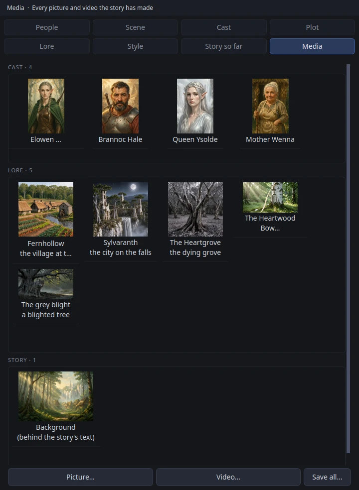

Pictures go to the chat endpoint unless **Settings → Images** names another:
an address, a key, and the service it is (NanoGPT, OpenRouter, WaveSpeed, or
any OpenAI-compatible `/images/generations`; worked out from the address
unless you choose). Left blank, the address is the chat endpoint's, and its
key is used only when the address is the chat endpoint's own host.

### Pictures of your own

Every picture you bring in from disk opens **Crop the picture** first: a
card's picture or portrait, **Add a picture from disk…** in the picture and
video dialogs, the background, a picture in the plot file editor, or a
painting of your own. Drag the frame to move it, a corner to resize it,
or across the picture to draw a new one. **Shape** leaves it free, to take
any part you like, or holds it to the exact shape the app uses:

- a portrait, or a place or lore picture, as your portrait model draws them;
- the background, as the story area is in the window now;
- a painting, in the shape of a map area (5:3), which it covers;
- a square, or the picture's own shape.

Each place opens it on the shape it calls for. **Use the whole picture**
keeps it as it is.

Whatever comes in has its hidden data removed before it is kept: where and
when a photo was taken, the camera, any thumbnail, comments, editing history
and anything after the image. Pictures in a scenario file or a story backup
are cleaned the same way as they are imported.

### Pictures for the cards

**Story → Draw pictures for the cards…**, **Draw a portrait…** on a cast
sheet, **Draw a picture…** on a lore entry, or the box in the Start dialog
gives each character a portrait and each lore entry a picture, drawn from
what their cards say. The Start dialog counts the characters and lore entries
with no picture yet (a plot file or a premise often brings none) and offers
them all at once; the opening then runs while they are drawn. The prompt
writer (Settings → Models → Image prompt writer, blank for the story model)
writes a prompt for each, describing only what a camera would see, never a
name. A lore entry with nothing to see (a rule, a history) is left unticked.
The dialog shows every prompt: change any you like, untick anything you don't
want drawn, choose the model and see the price, then **Draw**. Nothing is
drawn before that. Each picture goes first among its card's pictures, shown
large on the Cast or Lore page, and is kept in Media with its prompt and cost.
Characters the plot hasn't brought in yet, and lore held back until you
mention it, are never offered: their picture would tell a model about them
early.

Under a card's large picture the buttons are grouped by what goes to the
image model with the prompt, and every dialog says it again on a line of its
own (**Sent with the prompt:**):

- **From words:** **Draw a new portrait…** (a new picture from the card's
  description) and **Same prompt again…** (another take from the picture's own
  prompt, or one written from the card for a picture added from a file). The
  picture itself isn't sent; a picture that was itself drawn from others (a
  changed copy, a picture in a scene) is drawn again from those same pictures.
- **Sends this picture:** **Change this picture…** makes a changed copy: say
  what to change (a scar, other clothes, another background, years older) and
  the picture goes with that, so the face and everything else stay. **In a
  scene…** (a character) pictures them alone as they are at this moment of the
  story, where they are, what they wear and are doing, with their pictures sent
  so it is the same face; the story's own prompt writer, which has read the
  story, writes it, in the usual picture dialog.

The small pictures under the large one offer **Same prompt again…** and
**Change this picture…** too.

Many image models come in two versions, one drawing from words and one
changing a picture (FLUX.3 Klein, Seedream 5.0 Pro, Nano Banana Pro…). You
only ever choose the model: **Browse…** lists each model once, its
**Pictures** column saying how many pictures it can be given ("none" for a
model that draws from words alone, "needs one" for one that only changes a
picture), and beside every image model field a few words say the same
(**takes pictures**, **words only**, **edits a picture only**; the tooltip
says more). When a picture goes with the prompt its edit version is sent,
with none its text version (an edit version given no picture fails), and the
dialog names the version it sends.

A new picture is added to the card's pictures; the original stays. **Make
portrait** (**Show first** on a lore entry) puts the one you like first, and
**Remove** takes off the one you don't.

The portrait model is Settings → Images → **Portrait model**; **Recommended**
beside it lists the models measured for portraits, with what each is good at:

- **FLUX.3 Klein** (the default, about $0.009, a few seconds): ahead of FLUX.2
  klein on five of six characters for two blind judges, and its edit version
  changes a picture best of those tried while keeping the face. Its portraits
  are square.
- **Seedream 5.0 Pro** (best, about $0.09, or $0.045 at 1k): the best pictures
  of those offered, tall portraits, up to ten pictures.
- **FLUX.2 klein 9B** (the earlier default, about $0.01): tall portraits, but
  last on five of six characters against FLUX.3 Klein.
- **Z Image Turbo** (about $0.012) and **Recraft V4.1 Flash** (about $0.008):
  as good or better for a single portrait, Recraft's the most striking, but
  neither can be given reference pictures, so they can't keep a character the
  same from one picture to the next.
- **Seedream 5.0 Flash** (about $0.027): very finished, with up to ten
  reference pictures, between FLUX.3 Klein and Seedream 5.0 Pro in price.

## Videos

**Story → Generate video…**, **Video…** in the Media tab, or **Video of this
passage…** in a passage's ⋯ menu makes a few seconds of video of the story.

**Video costs far more than pictures**: a picture is a few cents, a video tens
of cents to over $10 for a few seconds, and it is charged when it is sent,
even if you stop waiting or delete it afterwards. So:

- **Video is off until it has an API key of its own**, in **Settings →
  Video**. The app never uses the chat key for it. Make a key for video alone
  at the service and set a daily spending limit on it there (on NanoGPT, when
  you create or edit the key): that limit is the one that holds whatever
  happens in the app. When the limit is reached the service refuses, and the
  app says so rather than trying again. You may type your chat or picture key
  in there instead; then every video warns you and asks again before it is
  sent.
- **The dialog says first what this video will cost**, in dollars and in
  pictures' worth, worked out from the model's own price list, and **Generate
  video** stays off until you tick that you accept that price. Changing a
  setting that changes the price clears the tick. When the price can't be
  worked out (some models list theirs in ways that proved wrong, and the app
  won't guess), you tick that you accept an unknown price instead. If the
  service charges more than the dialog showed, the app tells you.

The dialog shows the model's own settings (resolution, length, aspect ratio,
sound and so on, from the service's list; **Browse…** finds another model),
and only values that list offers are sent. **Starts on** and **Ends on** take
any picture of the story: a reference picture from a card, a picture it made,
one from disk, or the last frame of an earlier video, which carries a scene
on. Models that can't take them say so. **Write prompt** asks the prompt
writer (the same one as pictures) for a prompt written for video: one
continuous shot of that length, what moves, what the camera does, and what is
heard if the video has sound, starting from the picture chosen. Change the
length, sound or pictures afterwards and write it again. The prompt is sent
exactly as it stands in the box.

The video is made in the background, which takes a few minutes; its place
after the passage says so, with **Stop waiting**. It is already paid for, so
it is never lost: stopped, or with the app closed, it is fetched when you
press **Check again** or next open the story. (In a chat kept in memory only
it is lost with the chat, and closing the chat says so.) When it arrives,
its hidden data (the encoder's name and settings, creation times) is blanked
without re-encoding, and it shows as its first frame: click to play it in
place, with sound and a position bar. Its ⋯ menu opens it in your default
player, saves it, shows its prompt, makes the next video from its last frame,
or uses that frame as a reference picture. Videos are listed in the Media
tab and saved by **Save all…**. A story backup of a story with videos asks
whether to put them in (they are megabytes each) or leave them out.

The default is Seedance 2.5 at 480p for 5 seconds with sound, on NanoGPT
($0.90 when this was written). **Settings → Video** also takes another
service's address: OpenRouter's video API (`https://openrouter.ai/api/v1`) and
WaveSpeed (`https://api.wavespeed.ai/api/v3`, which quotes each request
itself) are supported.

## Private scenes

The **Private** button beside the composer plays a span of the story on a
separate model that nothing else ever hears about: a local server (Ollama, LM
Studio, llama.cpp), or a NanoGPT `TEE/` model. For a TEE model the app
attests the enclave when the scene begins, before anything is sent:
- the Intel TDX quote, read from its own signed bytes, must bind the enclave's
  signing key to a fresh nonce of ours;
- the quote must verify up to Intel's root, not be revoked or a debug
  enclave, and Intel rates the machine's firmware;
- NVIDIA's signed verdict on the GPUs must be for our nonce and pass.

Providers that run several instances (such as `TEE/kimi-k3`) have every
instance checked the same way. Anything forged, revoked, for another nonce,
or a model that offers no attestation is **refused**, and nothing is sent to
it. What couldn't be checked (no GPU evidence offered, Intel's or NVIDIA's
service out of reach, a rating below up to date) is shown as **partial**,
with the reason on the model button. Each reply's signature record must be
signed by the attested key; the transcript marks such replies "TEE signed",
or "TEE signature unavailable" when the provider signs none. Your own
messages are marked with how they were sent: "sent to the attested TEE", or
"end-to-end encrypted" on a `private/` model.

**Check TEE models** (Settings → Private, on by default) is that whole check
for `TEE/` models. Switched off, a `TEE/` model is used like any other: no
attestation, no signature checks, no marks on the messages, and the model
button says "⚠ not checked" for as long as the scene or chat lasts, so you
can't turn it off and forget. A `private/` model is always attested, whatever
the switch says: its key is what everything is sealed to.

**Test attestation** (beside the model in Settings → Private and New simple
chat, and under the model list when a TEE or encrypted model is selected)
runs that same check before you choose the model. It reports whether the
model attests in full, partially (and why), or is refused, so you know it
works before a scene or chat depends on it. The details are in its tooltip.

What it doesn't prove: which software the enclave runs, or that a reply's
content is what was signed (NanoGPT hashes the request as its gateway
received it, which the app cannot reproduce). And the text still passes
NanoGPT's gateway in the clear; for that, use a `private/` model (below). Everything else the
app does with the story is paused while the scene is open, including the
scene and plot reads, so the scene card and the plot are frozen until it ends.
Ending the scene asks the private model for a summary; you approve, edit or
discard it, and the approved summary is all the story's model will ever know
of the scene. If the summary is stopped or fails, you can ask again, end the
scene without a summary, or keep playing. While a scene is open, Settings,
switching stories or branches, the review and Restart are paused (the app
says so when the scene begins); end the scene to use them again. **In memory** keeps the scene's messages off the disk
altogether (closing the app loses them); **On disk** keeps them as a side
branch no model is sent. A scene that outgrows the private model's context is
condensed by the private model itself, never by the story's. Set the model under Settings → Private, where
**Detect** asks a local server how much context the model is running with. The
endpoint there starts as NanoGPT's, and with its key left blank it uses the
main endpoint's key; only the model is left to choose, and private scenes stay
off until one is.

**End-to-end encrypted models (`private/…`).** NanoGPT's Private Mode
models (`private/glm-5-3`, `private/kimi-k3`, `private/gemma4-31b` and the
rest; Browse… lists them as "end-to-end encrypted") close the gap above: the
prompt is sealed on your machine to a key only the model's enclave holds, and
the reply comes back sealed the same way, so NanoGPT relays ciphertext.
Before anything is sent the app attests the enclave with Tinfoil's own
verifier:
- the hardware's signed report must match the router code Tinfoil
  published, as recorded by Sigstore;
- that report must bind the key the message is sealed to;
- the release must be the latest one on Tinfoil's GitHub, or the model
  button says "⚠ older release".

Replies are marked "end-to-end encrypted", and the attestation is redone
every five minutes. Wherever you choose a model, the model list's Privacy
column and the label beside the model field say which kind a model is: "🔐
End-to-end encrypted", or "TEE" (and, for a TEE model with an encrypted
version, its name).

NanoGPT retires Private Mode models from time to time. If the model you
chose is no longer offered, the app says so when the scene or chat begins
(and Test attestation shows "✗ No longer offered"), and nothing is sent to
it. A private scene can carry on with another end-to-end encrypted model
NanoGPT still offers (**Use another model…**, or **Summarise with another
model…** when you end it), which then writes the scene's summary; new scenes
use the model under Settings → Private, so choose another there too. For a
chat, choose another with the model button.

What NanoGPT still sees: your account, which model, when, how large the
request and reply are, and the usage and cost. NanoGPT reserves a charge for
up to 32,768 output tokens before each reply and refunds the unused part, so
keep some balance in hand. The prompt cache is keyed by a secret the app
makes and seals inside the request, so no one else can probe it (NanoGPT
issues its own secret; the app keeps its own instead).

The app doesn't use NanoGPT's `@nanogpt/private-mode` proxy. That proxy is
run with `npx …@latest`, so NanoGPT could change the code that holds your
plaintext at any time. Instead the app uses Tinfoil's Python library, pinned
by hash like everything else in the AppImage. The AppImage is reproducible,
so you can rebuild a release and compare its checksum. Tinfoil's library
keeps Sigstore's public trust root in `~/.cache/sigstore-python` and
`~/.local/share/sigstore-python`; nothing from your story is kept there.

## Simple chat

**Have a simple chat** (on the start page, or File → New…) is a plain
conversation with a model in
SealedLore's window: your system prompt and your messages, sent exactly as you
write them, with none of the storytelling around them (no rules, cast, lore,
scene, plot or side models). Branches, takes, Edit, Find, pictures and the
cost all work as in a story, and a long chat is summarised in parts as a
story is (Settings → Context), with a plain summariser.
- **Keep in full** (a message's ⋯ menu) sends a message word for word even
  once its part of the chat is summarised: it rides after that part's
  summary. Your first message starts kept. Story so far says when kept
  messages take more than a fifth of the budget.
- The system prompt is set when you start the chat and under **Story →
  Setup…** afterwards; a change costs one cache miss. Beside it, the **Tail**
  (also set at the start) is fixed text sent after your message at the end
  of every request (a style reminder, a standing rule). It is never saved
  into the conversation.
- **A part of a chat can be held in private**, as a scene of a story can
  (see "Private scenes"). The **Private** button beside the message box sends
  what you write next to your private model (Settings → Private) and to
  nothing else; the chat's own model sees none of it. Beside it you choose
  whether that part is kept **In memory** (gone when the app closes) or **On
  disk**; a chat kept in memory only keeps its private parts in memory too,
  so it doesn't ask. **End private** has the private model write a summary for you to
  approve, change, or do without; what you approve joins the chat, marked as
  a summary of a private part, and is all the chat's model ever reads of it.
  While a part is open, Settings and switching to another chat or story are
  paused. A chat on a TEE model has no Private button: all of it is private
  already.
- **On a NanoGPT `TEE/` model** the chat is private as a private scene is:
  the enclave is attested when the chat opens (unless Check TEE models is off
  under Settings → Private, which the model button then says), each reply is
  checked to be signed by it ("TEE signed"), every call (summaries and
  picture prompts included) goes to that model, and the chat can move only
  to another TEE model. The text still passes NanoGPT's gateway, as a
  private scene's does, unless the model is a `private/` one: then it is
  end-to-end encrypted (see "Private scenes"), and the chat can move only to
  another `private/` model.
- **A chat can keep a map**, as a story can (see "The map"): tick **Keep a
  map of the conversation** when you start it, or later under **Story →
  Setup… → About**. Once the conversation sets a scene, the map model reads
  each reply for the places, who is where and the things that matter, the
  local area is drawn, and the map grows as the chat goes; the map is sent
  with each message, as a story's is. A chat has no cast, so the map tracks
  you by the name beside the box (your character's name, or "You" when
  blank). It is one more small call after every reply. In a TEE chat the
  map is read and drawn by the chat's own model, and map pictures from an
  image model stay off (the image endpoint is not private).
- **Where a chat is kept** is asked when it starts, on any model: **On
  disk**, like any story, or **In memory only**. Nothing of an in-memory
  chat is written on this computer, not even its log, and it teaches the
  settings nothing (changing its model doesn't change your default). It
  isn't in the Stories list, and closing it asks first, since it is then
  gone. Its pictures are kept in memory with it (reference pictures and the
  background too). To keep anything, write it out first: **Story → Export →
  Story backup…** (the whole chat, its pictures and costs), Markdown, or
  **Media → Save all…** for the pictures and videos. File → Import… of such a backup
  asks whether to open it in memory again, writing nothing, or save it as an
  ordinary chat. In memory only is about your computer, not the model: on an
  ordinary model the provider still receives every message (on NanoGPT, your
  account's data retention setting applies there).

## Playing from your phone

Phone access lets a phone play the stories and chats you choose, from Tor
Browser, wherever the phone is, while SealedLore runs on your computer.
SealedLore runs its own tor and gives your computer an onion address, so
there is nothing to set up on your router, no port is opened, and there is
no account or service in between. It is off until you turn it on, and while
it is off nothing of it runs, listens or can be reached. For now it works on
Linux, and for stories and chats that don't keep a map (Story → Continue
without the map… makes a copy that can go on the phone).

The phone needs **Tor Browser** (from the Tor Project, through Google Play,
F-Droid or torproject.org), at its Standard or Safer security level: the page
needs scripts, which Safest turns off.

**Turning it on.** **File → Phone access** turns it on for as long as
SealedLore runs. A small onion then shows in the status bar with what tor is
doing: "Phone: connecting 45%" while tor joins the Tor network (usually ten to
thirty seconds, now and then a few minutes), then "Phone: ready", or
"Phone: 1 connected" while a phone is playing; a click on it opens the phones
and stories. Unticking File → Phone access stops tor and closes every phone's
connection, and so does quitting. To have it start with SealedLore, tick
Settings → Phone → Turn phone access on when SealedLore starts (off unless you
tick it); Settings → Phone → Say when a phone connects shows a notice when
one does.

**Choosing what the phones see.** Nothing is shared until you choose it. Tick
the stories under **Stories on your phones** in **File → Phone devices…**, or,
while phone access is on, right-click a story in the Stories list and tick
**Share with phone**; a shared story's row then says "on your phones". A
phone lists and opens only those, and gets nothing at all from any other:
while the desktop has a story open that isn't shared, the phone says only
"The story open on the desktop isn't shared with this phone", not even its
title. What is shared is kept on this computer, not in the story, so a
backup, a copy or a scenario of it starts out unshared. A memory-only chat
can be shared from the same list for as long as it is open, and that choice
is never written down.

**Pairing a phone.**

1. On the phone, open Tor Browser and let it connect.
2. On the computer, open **File → Phone devices…** and choose **Pair a
   phone…**. It shows a QR code, the link it holds, and **Copy link**.
3. Scan the code with the phone's camera, tap **Copy**, and paste the link
   into Tor Browser's address bar. (The camera opens links in the phone's
   usual browser, which can't reach an onion address, and Share doesn't offer
   Tor Browser.) A code works once, for five minutes, and closing the window
   ends it.
4. On the phone, give it a name and tap **Connect**. The computer asks
   whether to allow the phone and shows four digits: allow it only if the
   phone shows the same four.
5. Bookmark the page the phone then shows (⋮ menu → ☆) and tap **I've
   bookmarked it**. **The bookmark is the phone's login**: Tor Browser forgets
   its pages when it closes and has no "Add to home screen", so open the
   bookmark each time you play. Whoever has the bookmark can play what you
   share, so keep it like a password.

**Playing.** The phone shows the story open on the desktop, and the two stay
together: a turn from either shows on both, and the passage is written on
both at once. Under the box are **Speaking as**, the length, and behind
**More** the outcome and, when a roll applies, the roll and its difficulty;
everything else (who you play, who the model may voice) is the desktop's
composer's. Send becomes Stop while a passage is written, and a turn sent
while the reads after a passage finish waits to go (Queue). Under a passage
are ‹ › for its takes, **Regenerate** and **Roll again**. The ☰ menu lists the
shared stories (opening one opens it on the desktop too), the story's
branches, and **Forget this phone**. Pictures in the story show small, and
whole when tapped.

Some things wait for the desktop: while a question is open there (a summary
to approve, say), the phone says "The desktop is waiting for an answer". A
private scene is begun and ended on the desktop.

**Private scenes, memory-only chats and private models** can be played from
the phone if their story is shared, and the computer asks first when you
share one. But whatever a phone shows is on that phone: Tor Browser and
Android may keep it (the open tab, screenshots and the recent-apps preview,
what the keyboard learns, backups), and SealedLore can't promise for a phone
what it promises for your computer. The first time the page reaches
something private it says so, full screen, and shows it only after **Show
it**; **Not now** leaves a placeholder you can tap later.

**Phones you no longer want.** **Revoke** beside a phone in **File → Phone
devices…** cuts it off at once; its bookmark stops working. **Forget this
phone** in the phone's own menu does the same from the phone (delete the
bookmark too). **New address…** gives your computer a new onion address and
forgets every phone, so each one has to be paired again: for when you think
a bookmark has got out. **Details** there shows tor's own latest messages.

**Why the link starts with http://.** An onion address is a key: tor finds
your computer by it, checks that it is talking to the holder of that key, and
encrypts everything from the phone to your computer. Tor Browser therefore
counts it as a secure page. A certificate would add nothing but a warning
page every time. SealedLore answers only requests made to its own onion
address, and everything but the page itself and pairing needs the phone's
login.

**Tor itself.** The AppImage brings tor (from the Tor Project's Tor Expert
Bundle). Run from source, SealedLore uses the `tor` program on your `PATH`
(see [System packages](#system-packages)); `SEALEDLORE_TOR` names another.
Either way it runs its own copy, with its own settings and its state in the
data folder's `phone` folder, never the tor service your system may run.

## The context budget and archiving

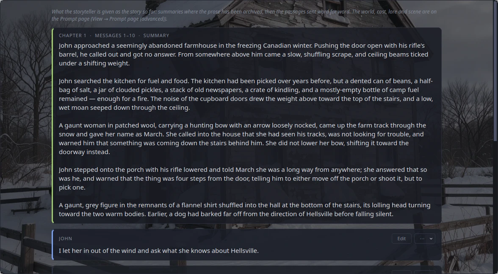

The **Context budget** (File → Settings → Context, with a story open) is how
many tokens the storyteller's whole prompt may use each turn: the rules,
world, cast and chapter summaries as well as the recent story word for word. When a prompt reaches it, the oldest whole chunk of
the story — ten exchanges by default — is summarised into a chapter, and the
chapter stands in for that prose from then on.

Archiving doesn't stop the moment the story fits again. It keeps taking whole
chapters until the prompt is down to **Archive down to**, 50% of the budget by
default, and then leaves the story alone until the budget is reached again.
Stopping at the budget line left only a few hundred tokens of headroom, so the
next few turns crossed it again and each of those paid for another summary and
another full re-send of the cached prompt. On a 216-turn test story at a 35,000
budget, stopping at the line bought 6 quiet turns; going down to half buys 31.
The same prose is summarised either way — just in fewer, larger runs.

An archival run summarises several chapters in a row, and the status bar names
each one as it lands. If the budget is too small to hold the story even fully
archived, it says that instead of spending every turn trying: a long story's
fixed parts — the rules, world, cast and the chapter summaries themselves — can
be several thousand tokens before a word of recent prose is added.

**Editing what has been archived.** Any message can be edited, archived or
not. An edit to a message that is still sent word for word simply goes as it
is. An edit to an archived message, or another take swapped in under a
chapter, marks that chapter stale, and a banner names it. Nothing is rebuilt
until you press **Rebuild affected summaries** (or **Rebuild** in **Story so
far**), so make all your edits first. The rebuild runs in the background while
you keep playing: the old summary is sent until the new one is in, and the
mark goes then. If you edit the same chapter's messages again meanwhile, that
summary isn't used and the chapter stays marked for another rebuild.

**Parts.** Once the chapter summaries take a fifth of the budget, the oldest
are merged into one part at about half their length; the newest three stay as
they are. Edit or rebuild a chapter inside a part and the part is taken apart,
its chapters sent instead until the next merge. Tick **Keep as written** on a
chapter in **Story so far** to keep it out of every merge: it is sent as it is
however long the story grows, and merging goes around it. A chapter you have
edited by hand is merged like any other unless you keep it.

**Recall.** A part is shorter than the chapters it stands for, so detail goes.
When you ask a Question, the two chapters most about it are brought back into
the storyteller's prompt in full. They are found by the words they and their
archived passages share with your Question (rarer words count for more) and
by your embeddings model; without an embeddings model the words alone do it.
The first time takes a few seconds while the chapters are read. What a
Question brought back stays in the storyteller's prompt for your next few
turns on that branch (**Keep a Question's recall for**, Settings → Context;
three by default), so the story keeps to what you were just told. **Recall
earlier detail** (Settings → Context) can also search the archived passages
themselves (slower the first time: about 25 seconds for a 250-exchange
story), or recall for every story turn as well. In testing, turns seldom
needed it, and it sometimes brought an old state back as though it were
current, so it is off there unless you choose it. **Story so far** shows what
the last turn or Question recalled, what it kept from a recent Question, and
what came next in line.

## The terminal client

A terminal client for the engine: the same stories, without the window.
`--mock` needs no endpoint or API key:

```bash
sealedlore new "The Sundering" --model anthropic/claude-sonnet-4.5
sealedlore list
sealedlore chat <story-id> --mock
```

Inside the chat REPL, `/help` lists every command: among them `/hold` (play
a character), `/present`, `/scene`, `/where`, `/privacy` (who can know what
happens here), `/speaker`, `/ooc`, `/mode`, `/dice`, `/len`, `/style`,
`/regen`, `/undo`, `/ask`, `/review`, `/inspect`, `/budget`, `/summaries`,
`/archive`, `/lore`. The length presets are named as in the app, with
`adaptive` for "Match my turn". To talk to a real endpoint:

```bash
sealedlore configure --api-key <key> --model anthropic/claude-sonnet-4.5
sealedlore chat <story-id>
```

## Where your data goes

Nothing leaves your machine except what the features below send, and every
endpoint must be `https://` (plain `http://` is accepted only for
`localhost`). The one exception the other way is phone access, which answers
phones over plain `http://` on its onion address, where tor encrypts the
whole way (see [Playing from your phone](#playing-from-your-phone)). There is
no telemetry, no update check and no crash reporting.

- **The chat endpoints** (Settings → Endpoints) get every prompt: the world,
  cast, lore, the recent story and your turn; the chapter summaries, scene
  and plot reads, character scans, settings reviews and image prompts made
  from the story; and a request for each one's model list when a price or
  the model picker needs one. Each call goes to the endpoint its model
  names, with that endpoint's key alone.
- **The embeddings endpoint** (Settings → Lore, off by default) gets the lore
  entries and a query built from the last few passages. Its key is only
  filled in from the chat key when it is the same host. A large lorebook's
  picks also go to the chat endpoint (the lore model), or, with "Jev before
  each turn", to its `/decisions` route with the lore and recent story.
- **The image endpoint** (Settings → Images; by default the chat
  endpoint's host) gets the approved prompt and the reference pictures you
  chose, and the picture comes back and is saved with the story (a reply that
  names a download link is fetched from that link, which may be a content
  network, without the key). WaveSpeed takes pictures as links, so the
  reference pictures are uploaded to it first. In a private scene the prompt
  is written by the private model but still sent there, with a warning in
  the dialog.
- **The video endpoint** (Settings → Video, off until it has a key) gets the
  approved prompt and the start and end pictures you chose (uploaded first
  to WaveSpeed), then is asked after the video until it is done; the video is
  fetched from the link it gives (NanoGPT's is a content network, fetched
  without the key) and saved with the story.
- **A private scene** goes to the private endpoint alone (Settings →
  Private): a local server, or a NanoGPT `TEE/` or `private/` model. Verifying
  a TEE model sends the enclave's GPU evidence, and nothing else, to NVIDIA's
  attestation service, and fetches Intel's public certificates, revocation
  lists and platform ratings (`api.trustedservices.intel.com`,
  `certificates.trustedservices.intel.com`) to check the enclave's quote. A `private/` model's attestation is fetched through
  NanoGPT and checked against Sigstore's public records and Tinfoil's latest
  release on GitHub; what the app sends it is sealed first (see "Private
  scenes"). Everything else the app does with the story is paused until the
  scene ends, and only the summary you approve goes back into it. "In
  memory" keeps the scene's messages off the disk; its calls are logged
  without content, so the cost still adds up.
- **Phone access**, off until you turn it on (File → Phone access): SealedLore
  runs its own tor, which talks to the Tor network's relays and publishes your
  computer's onion address there. The address's key is kept in the keychain
  like an API key, and tor's own state (the relays it knows) in the data
  folder's `phone` folder. Phones reach the computer only through tor, and
  only those you paired get anything, and only from the stories you share:
  their messages, pictures and what the composer offers. A phone's login is
  kept only as a hash. `config.json` keeps each phone's name, when it was
  paired and the day it was last seen, and which stories are shared. What a
  phone shows is on the phone, and Tor Browser and Android may keep it (see
  [Playing from your phone](#playing-from-your-phone)).
- **On first run from a source or pip install**, `tiktoken` downloads its
  token vocabulary from OpenAI's public file store; the AppImage bundles it.
  No data about you is sent.

On disk: settings are in `config.json` in the data folder (Help → About
SealedLore shows where). API keys are kept in the system keychain (GNOME
Keyring or KWallet through the Secret Service on Linux, Credential Manager
on Windows) and left blank in `config.json`. A computer without a keychain
keeps them in `config.json` in plain text, and so does choosing "config.json,
in plain text" under File → Settings → Endpoints → Keep API keys in (for the
command line or a test setup: `sealedlore configure --key-storage file`).
The note under each key field says where that key goes. A key already in
`config.json` from an older version moves into the keychain the first time
the window opens. The
folder and everything the app writes in it are readable by your user only.
Each story keeps every request and reply in its `api_log.jsonl`, so a story
backup (Story → Export → Story backup…) carries every prompt sent for it; a
scenario export carries only the setup. If the app ever crashes outright,
`crash.log` in the same folder gets the program's stack at that moment (file
and function names, nothing from your stories); it stays on your machine,
for you to send along with a bug report if you choose. The app also tells
the system not to keep a core dump of it (a copy of its memory), so a crash
never writes a memory-only chat or scene anywhere. Swap and hibernation are
the system's own and outside the app's reach: the system may write the app's
memory there, a memory-only chat or scene included. An encrypted disk, or
encrypted swap, covers them. On Linux you can also turn swap off while you
use the app (`sudo swapoff -a`, then `sudo swapon -a` afterwards); turning it
off moves what is already in swap back into memory, so it needs enough free
RAM. The app can't lock its own memory against swapping instead: an ordinary
user may lock only a few megabytes (`ulimit -l`), far less than it uses.

### On Windows

Everything sent over the network is the same on Windows: HTTPS only, the TEE
checks, and the sealing of end-to-end encrypted models. What differs is
what the app can promise on the machine itself.

- **The data folder is yours alone.** `chmod` means nothing on Windows, so
  the app gives the folder its own permissions instead: your account and
  SYSTEM, nobody else, carried down to every file in it. Administrators can
  still take ownership of it, as root can read anything on Linux.
- **A crash can leave a copy of the app's memory.** Linux can be told to
  keep no core dump; Windows can't, reliably. After a crash, Windows Error
  Reporting may save a dump, or send one to Microsoft, and it can hold part
  of a memory-only chat or scene. The app turns off the crash dialog, but
  not the report. To stop it, turn Windows Error Reporting off (or set
  `HKEY_CURRENT_USER\Software\Microsoft\Windows\Windows Error Reporting`
  `Disabled` to 1). The app won't change the registry for you.
- **Other programs you run can read the app's memory.** On Linux the app
  blocks this; Windows has nothing equivalent.
- **Memory can reach the disk**, as swap can on Linux. Windows writes memory
  to `pagefile.sys` and `hiberfil.sys`, which are unencrypted without BitLocker or Device
  Encryption. With Device Encryption on, its recovery key is usually stored
  in your Microsoft account.
- **Screen capture: private windows are left out.** While a private scene or
  a TEE or end-to-end encrypted chat is open, the window is kept out of
  screen capture. That covers Recall on Copilot+ PCs, screenshots, screen
  recordings and remote-desktop viewers: they show whatever is behind the
  window, as if it weren't there, and so will your own screenshots. The
  private summary dialog, and the picture dialog during a scene, are kept
  out too. This needs Windows 10 version 2004 or later.
- **Copying: some copies stay out of clipboard history.** Copy prompt and
  Copy review mark what they copy to be left out of clipboard history
  (Win+V) and the cloud clipboard. Text you select and copy with Ctrl+C is
  not marked, so turn off clipboard history if that matters.
- **OneDrive may upload exports.** Documents and Desktop are often synced
  to OneDrive. A story backup holds every prompt sent for the story, so
  save it somewhere that isn't synced if that matters.
